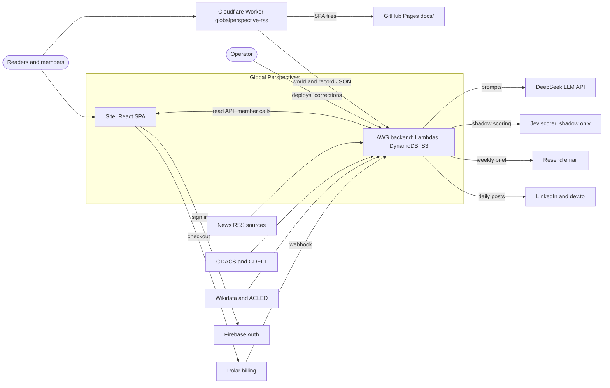
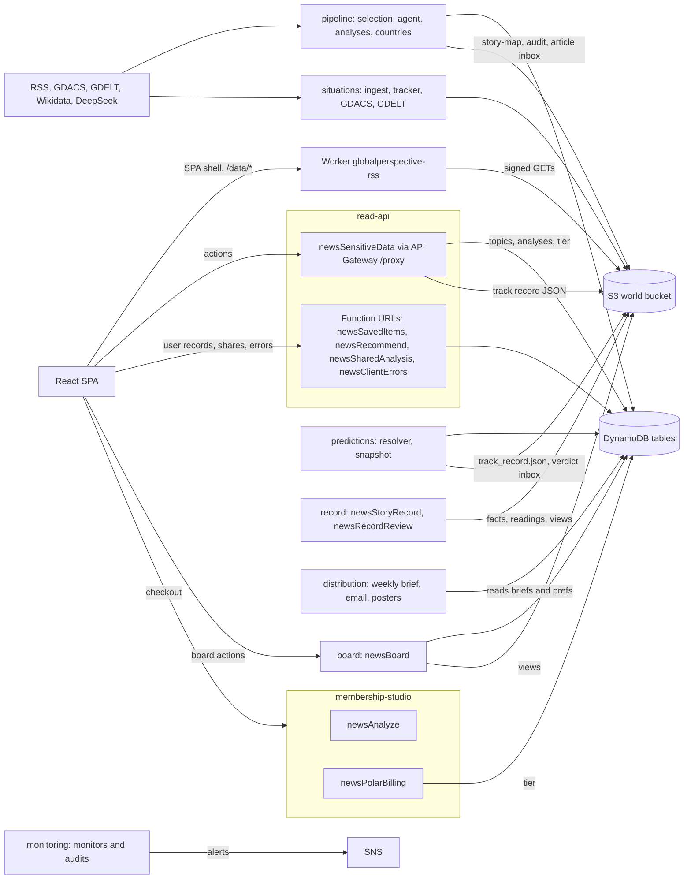
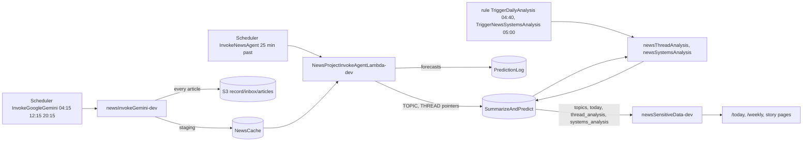
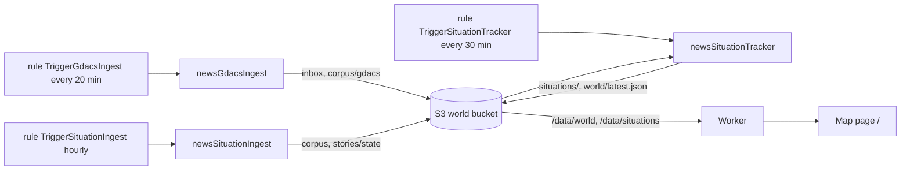
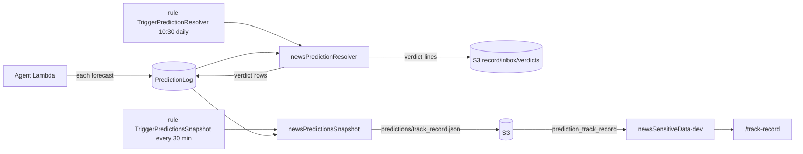
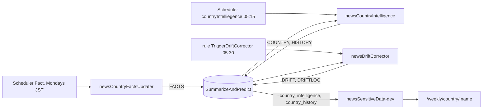

# Global Perspectives: Architecture

This is the map, not the inventory. Lambdas, schedules, env keys, routes, feature folders and S3 prefixes are read from the source of truth: `scripts/functions.json`, `aws lambda list-functions`, `aws events list-rules`, `aws scheduler list-schedules`, `src/app/App.jsx`, `ls src/features`, `aws s3 ls`. When this file and those disagree, they win. Area designs: [the record](ARCHITECTURE_TIMELINE.md), [forecast loop](ARCHITECTURE_FORECAST_LOOP.md), [weekly review and analyst weekly](ARCHITECTURE_WEEKLY_REVIEW.md), [board](ARCHITECTURE_BOARD.md), [ingest proposal](ARCHITECTURE_INGEST_DESIGN.md), [storage rules](DATA_STRATEGY.md), [world model](WORLD_MODEL.md). What is stopped or waiting right now: `project-docs/START_HERE.md`.

## Purpose
Global Perspectives (globalperspective.net) is an AI global-news intelligence site. Scheduled Lambdas pull news (RSS) and hazard feeds (GDACS, GDELT), use an LLM to select and explain the stories that matter, track situations on a world map, score country risk, make forecasts that are settled later in public, and send a weekly brief. Reading is free and needs no account. A paid membership (Polar) buys following countries and deeper history, not access to content.

## Bird's-eye view
### Context

Every pipeline Lambda that calls an LLM uses `api.deepseek.com`; the model is the live env value (`GROK_MODEL`, `PREDICTION_MODEL`, `REVIEW_MODEL`, `AUDIT_MODEL`). The weekly email rule (`TriggerWeeklyEmailSend`) is ENABLED with `EMAIL_SEND_DRY_RUN=false`; the breaking and drift email rules are DISABLED; `newsPostLinkedin` (every 3 h, JST) and `newsPostDevTo` (daily, JST) are ENABLED.

### Containers

Two stores, split by kind of data ([DATA_STRATEGY.md](DATA_STRATEGY.md) holds the rules): DynamoDB for the older topic and analysis tables and for per-user mutable records; the private S3 "world" bucket for everything computed about the world, including the record. The browser never talks to S3 directly, only through the Worker's `/data/*` route.

## Codemap
Paths are named, not linked; search for them.

### Backend: `backend/<group>/<dir>/src/`
Lambdas are grouped by feature (decision 0024): `backend/<group>/<dir>/` with `src/`, `test/` and a README. Nothing is deployed with Amplify; each Lambda is deployed by hand (see Deploy). `scripts/functions.json` maps each deployed name to its repo dir, runtime, group and schedules. Names that surprise:
- `newsInvokeGemini` (deployed `newsInvokeGemini-dev`) is topic selection. Despite the name it calls DeepSeek.
- `NewsProjectInvokeAgentLambda-dev` and `newsSensitiveData-dev`: the `-dev` suffix is production.
- `newsPostLinkedIn` deploys as `newsPostLinkedin` (lower-case "in").
- The Scheduler entry for country intelligence is named `countryIntelliegence` (the typo is real).
- `backend/membership-studio/_sandbox/` holds the deploy script for the `-sandbox` twins of `newsAnalyze` and `newsPolarBilling` (no repo src of their own).
- `newsAnalyze/deployed-snapshot/` is what actually runs; `newsAnalyze/src/` is not.

Groups: `pipeline` (selection, story writer, analyses, country risk), `situations` (map pipeline), `predictions` (resolver, snapshot), `record` (`newsStoryRecord`, `newsRecordReview`), `board` (`newsBoard`), `distribution` (email, social), `read-api` (proxy and Function-URL endpoints), `membership-studio` (billing, and `newsAnalyze`, which the site no longer calls), `monitoring`, `economy-parked`. `backend/weekly/` (the analyst's weekly) holds the schema and section model only, no Lambda yet.

**Invariant:** code shared between Lambdas lives once, in `backend/shared/src/` (`llm.js` the one LLM client and `[usage]` cost line; `world/` the only reader of raw tables; `record.js` and `placement.js` for the record; `placeFilter.js`, `resolveIso3.js` canonical country names, `riskDimensions.js`, `situations-core.js`). Each consumer reaches it through a committed `src/_shared` symlink; `scripts/lambda.sh` copies the real files into the zip. Never copy these into a Lambda.

Country names are canonical at the writers (United States, DR Congo, UAE; `resolveIso3`), so one country is one record; briefs, forecasts, drift notes and shares carry related ids (`iso3[]`, `threadId`).

### Frontend: `global-perspectives-starter/frontend/`
React + Vite SPA. Build output goes to the repo-root `docs/`.
- `src/app/`: routing (`App.jsx`), redirects for retired URLs, layout and chrome, the error boundary.
- `src/features/<name>/`: 13 feature folders (`account`, `analysis-studio`, `board`, `breaking`, `briefings`, `countries`, `economy`, `home`, `map`, `static`, `threads`, `track-record`, `weekly`), each owning its pages, components, hooks and lib. `map` owns `/`, `home` owns `/today`, `threads` owns `/weekly` and the story pages, `countries` the country pages, `board` `/board`, `analysis-studio` only the shared-run page `/analyze/s/:id` (`/analyze` is a redirect in `app/`). `weekly` is the planned analyst-weekly page and has no route yet. `/weekly`'s Countries section is `countries`' `CountryListPage`, handed to `WeeklyPage` by `App.jsx` as a prop so `threads` never imports `countries`. Routes: `App.jsx`.
- `src/features/<name>/index.js`: a feature's public API, only what other features and `app/` import (route pages are not in it; `App.jsx` lazy-loads them by path). `account`, `analysis-studio`, `static` and `weekly` have none.
- `src/shared/`: `api/restProxy.js` (the one client for the proxy and the Function-URL endpoints), `contexts/AuthContext.jsx`, `styles/` tokens, `lib/` pure helpers, `hooks/` shared data hooks, `ui/` shared blocks, `map/` the map drawing kit.
- `worker/` + `wrangler.jsonc`: the Workers Static Assets site (`globalperspective-site`), prepared but not the production path.

**Invariant:** imports flow `app -> features -> shared`. ESLint `no-restricted-imports` fails a `shared/` file that imports `@/features` or `@/app`, and a `features/` file that imports `@/app`. Another feature is imported only through its index (`@/features/<name>`); tests and lazy `import()` are exempt. Feature-to-feature imports must not form a cycle (`quality/check_feature_cycles.mjs`, run by pre-commit with the other `quality/check_*.mjs`).

**Invariant:** imports inside `src/` use the `@/` alias. The exceptions are the few files that Node tooling outside `src/` imports by relative path; they carry a header comment saying so.

### Edge: `cloudflare/front-worker/`
`production/worker.mjs` is the repo copy of the `globalperspective-rss` Worker that fronts production; `baseline/worker2.mjs` is the captured deployed source; `candidate.mjs` wraps it for `next.globalperspective.net`. The Worker SigV4-signs GETs to the private S3 world bucket for `/data/*`, allow-listed (`DATA_ALLOWED`) to `world/*.json`, `situations/state/`, `stories/state/` and `record/views/`, never facts, runs, inboxes or readings. It also proxies `/rss` to the proxy's `rss` action, pre-renders pages for bot user-agents, and returns the SPA shell with a 200 for other GET paths.

### Operator tools
- `scripts/`: `lambda.sh` (diff, package, deploy, rollback one Lambda, driven by functions.json), `audit-lambda-drift.sh`, `errors.mjs`, and on-demand checks (`smoke-test.mjs`, `link-crawl.mjs`, `auth-guard-check.mjs`, `contract-check.mjs`, `situations-log.mjs`).
- `quality/`: the frontend verify gate (`verify_pages.sh` and ratchets such as `check_color_literals.mjs`, `check_shared_blocks.mjs`, `check_docs.mjs`), eval harnesses.
- `predictions/`: `settle-correct.js` (list settled and due questions; correct a verdict with a reason), `verify-draw.mjs`.
- `backend/<group>/cli/`: operator CLIs next to their Lambdas: `distribution/cli/`, `pipeline/cli/threads.mjs` (list-joins, merge, split; print-only without `--apply`), `record/cli/` (recovery, actor reconciliation, assignment benchmark), `economy-parked/cli/`.
- `deploy.sh` (repo root): frontend verify, build, package and release targets.

## Data flows
Times are UTC unless noted; exact cron expressions and ENABLED/DISABLED state come from `aws events list-rules` and `aws scheduler list-schedules`.

### 1. Topic selection and daily stories (DynamoDB)

1. `newsInvokeGemini-dev` (three times a day) reads 26 RSS feeds (up to 25 items per feed fetched, 8 per feed in the prompt), asks the LLM to pick and cluster the day's topics under the done-not-said rule, with code dedupe and a significance floor (decision 0040), and writes them to `NewsCache` item `id='staging'`. Before the model call it writes every fetched article to S3 `record/inbox/articles/` (raw capture, no model), so a model outage cannot lose the news; it also writes `audit/ingest-capture/`. It fails the run on a model error. No web search in ingest.
2. `NewsProjectInvokeAgentLambda-dev` (10 minutes later) reads `staging`, writes a summary, cause trace and forecast per topic to `SummarizeAndPredict` (`TOPIC#…` keys, each carrying `threadId`), logs each forecast to `GlobalPerspectivePredictionLog`, assigns thread ids (writing `threads/story-map.json` to S3 by matching against `stories/state/`; a topic joins a thread only at composite score at least 0.4 and keyword overlap at least 0.15, each join logged as `[join]`; repair with `backend/pipeline/cli/threads.mjs`), swaps `staging` to `latest`, updates the archive and writes the thread to topic pointer `THREAD#<threadId>` / `TOPICS`. It reconciles each `PRED#` row to the entry's final `threadId`. Forecasts are drawn at most weekly per story (ARCHITECTURE_FORECAST_LOOP.md).
3. `newsThreadAnalysis` (daily) writes per-thread analysis and dated history (`THREAD#…` / `THREAD_ANALYSIS`, `THREAD_HISTORY#<date>`); `newsSystemsAnalysis` (daily) reads those and writes causal webs (`SYSTEMS#…`, `WEB#INDEX`, `THREAD#…/WEB`), plus a daily snapshot to `web/YYYY/MM/DD.json` and `web/latest.json`.
4. `newsSelectionShadow` runs a candidate layered selector (corpus plus GDACS, scored by an external model "Jev") against what was published and writes only `audit/selection-shadow/`. Nothing on the site reads it.

The site reads all of this through `newsSensitiveData-dev`.

### 2. Situations and the map (S3)

1. `newsGdacsIngest` (every 20 min, no LLM) overwrites the Orange/Red observations to `situations/inbox/gdacs-latest.json` and the full snapshot to `corpus/gdacs/latest.json`. It is the only inbox opener.
2. `newsGdeltConflict` (every 6 h, no LLM) writes conflict events to `corpus/gdelt/<day>.json`; only the parked impact audit reads them.
3. `newsSituationIngest` (hourly) reads RSS, classifies each headline with the LLM (country, location, axis, severity; cached in `stories/classify-cache.json`), clusters deterministically, and writes `corpus/<date>/<hour>.jsonl`, `stories/state/`, `stories/index.json`.
4. `newsSituationTracker` (every 30 min, no LLM) is the only writer of `situations/` state and `world/`: it folds the inbox, clusters and the thread story-map into `situations/state/`, `situations/index.json` (news situations keyed `news#<ISO3>#<threadId>`), `situations/history/`, closed situations into `situations/archive/`, and assembles `world/latest.json` (plus dated snapshots and `world/latest.member.json`).
5. The map feature fetches `/data/world/latest.json` and `/data/situations/state/<id>.json` (`src/features/map/api/worldData.js`) through the Worker.

**Invariant:** each S3 prefix has one writer (DATA_STRATEGY.md §4). Add a writer only by changing that table first.

**Invariant:** `*.member.json` is never served. The Worker's member check is a stub that always refuses, so any key containing `.member.` returns 401 until a real JWT check exists.

**Invariant:** `signals/` is built by `newsSignals` and served only by its own key-gated Function URL, never added to the Worker's allow-list. The Signals API is parked (decision 0032); `TriggerSignalsBuild` is DISABLED.

### 3. Forecasts and the track record

The agent Lambda writes forecasts to `GlobalPerspectivePredictionLog`. `newsPredictionResolver` runs the forecast loop (decision 0038): each night it watches open branches on stories that moved or fell due, gathers the story's own entries after the draw from `record/facts` (no web search), judges with a boxed model, and records a verdict put-once in the log and as a line in `record/inbox/verdicts/`, which `newsStoryRecord` turns into a `verdict` fact. It still commits a weekly random seed and draws the pre-registered sample of 22 questions that the public track record scores. Yes, no and void verdicts are final at once (decision 0034); the operator can append a correction with `predictions/settle-correct.js`. `newsPredictionsSnapshot` (every 30 min) scans the log into `predictions/track_record.json`; the proxy action `prediction_track_record` serves that file to `/track-record`.

### 4. Country risk and living analysis

`newsCountryFactsUpdater` (weekly, Mondays JST) writes current facts from Wikidata and ACLED to `FACTS#<country>`. `newsCountryIntelligence` (daily) reads thread analyses and facts and writes `COUNTRY#<name>` / `COUNTRY_INTELLIGENCE` plus a dated `HISTORY#<date>` snapshot. `newsDriftCorrector` (daily) compares snapshots; when a risk level, score (change of 8 or more) or trajectory moves, it grounds the move in a real archived event and writes a note (`DRIFT#<date>`, 60-day TTL; permanent `DRIFTLOG#<date>`). The original analysis is never overwritten. None of these, nor the agent Lambda, runs a web search; Brave code remains only in the parked `newsPairIntelligence` and `newsWeeklyMarkets` (the resolver's `BRAVE_SEARCH_API_KEY` env is unused by its code).

Risk tiers are 0-24 low, 25-49 moderate, 50-74 elevated, 75-100 high: `src/shared/lib/riskTiers.js` on the frontend, `tierFromScore` in `riskDimensions.js` on the backend.

**Invariant:** a risk tier is never a traffic-light colour. Risk shows as a number, a tier word and a ring weight; the `--tier-*` tokens are neutral greys that get brighter with the tier, and `TierChip` has no fill. `quality/verify_pages.sh` fails if a `--tier-*` token gets a hue or `TierChip.css` gets a background.

### 5. Email and distribution

- `newsWeeklyBrief` (Sunday) writes `WEEKLY_BRIEF#<week>` to `SummarizeAndPredict`, published directly. `newsEmailSender` mode `weekly` (Sunday, later) sends it with Resend to subscribers in `GlobalPerspectiveUserPrefs` (`digestOptIn`), logging each week so it is never sent twice. Its `breaking` and `drift_alert` rules are DISABLED. This is the old digest; the analyst's weekly (ARCHITECTURE_WEEKLY_REVIEW.md §9) will replace it, then `newsWeeklyBrief` retires.
- `newsBreakingAlert` (every 8 h) scores stories deterministically, records proposals in `GlobalPerspectiveBreakingAlerts`, and with live `DRY_RUN=false` emails each detection to a single operator address. It does not email subscribers. A breaking alert shows on the site only when the operator has `confirmed` it (`review.js`); the operator email is marked "[Unconfirmed] NOT PUBLIC YET". This is separate from verdicts, which have no human gate.
- `newsPostDevTo` publishes a daily brief to dev.to; `newsPostLinkedin` posts to LinkedIn. Both log to `NewsProject-linkedin-posts`.
- Subscription preferences and unsubscribe go through `newsRecommend` (Function URL).

**Invariant:** user-facing sends are switched on only by the operator. A disabled email rule stays disabled until an explicit decision.

### 6. Analysis Studio (retired) and the country sheet
The lens Studio is gone from the site (decisions 0030, 0033). `/analyze?stories=<id,...>` redirects to the first id's story page when it is a thread id (`thread-...`), otherwise to the countries list (`app/LegacyRedirects.jsx`; the front Worker sends the same as a real 301 and never bot-renders `/analyze/s/*`). Kept:
- Shared-run pages: `newsSharedAnalysis` still serves shares from `GlobalPerspectiveShares` (read by id is public, `noindex`); the SPA renders them at `/analyze/s/:id` so links already out there work. The site can no longer create a share.
- `newsAnalyze` and the prompt, validator and context libraries in `src/features/analysis-studio/lib/`: no page calls them; the share Lambda copies some (checked by `scripts/check-shared-sync.mjs`) and the offline eval harness in `quality/analysis/` imports them.
- The country page (`/weekly/country/:countryName`) is the "sheet": fact and judgment marks on every section, a computed "What we don't know", Copy as text, Print and a private "Your view". It reads stored data only; no model runs on view.

**Invariant:** the deployed `newsAnalyze` differs from `newsAnalyze/src/` (the repo carries parked credits code). Never deploy the repo file over it without a fresh go-live decision; `lambda.sh` refuses functions marked `deployBlocked` in functions.json.

### 7. Billing (Polar)
`newsPolarBilling` (Function URL) has three paths: the Polar webhook (Standard Webhooks signature), `create_checkout` and `get_membership` (both need a Firebase JWT). The webhook writes `tier`, `subscriptionStatus` and `billingProvider='polar'` onto the user's row in `GlobalPerspectiveUserTable`. `/membership` and `/account` read it back through `get_membership`. Credit packs are parked (decision 0002): the code path exists, but the live function has no `POLAR_CREDIT_PACKS` key.

### 8. The record
The site's memory is one append-only record in the world bucket (`record/`): facts, readings and notes. Facts (what happened) are appended daily with no model by `newsStoryRecord` (`record/facts/YYYY-MM-DD.jsonl`). Readings (what it meant) are written weekly, with hindsight, by `newsRecordReview` (`record/readings/YYYY-Www.jsonl`; rule `TriggerRecordReview`, Mondays 01:00 UTC, one model call per active story), each reading citing facts and able to supersede an earlier one. Views under `record/views/` are rebuilt from both by `newsStoryRecord`, the only builder, and served through the Worker (`/data/record/views/`). Nothing is edited in place. Today only the board reads the views; the other pages read DynamoDB through the proxy, and moving them is plan step 4 (ARCHITECTURE_TIMELINE.md §7). Notes (what a model wrote about something the record names: the per-entry summary, forecast and cause, story analysis, drift, country briefings, story-web links, briefs) go to `record/notes/<subtype>/YYYY-MM-DD.jsonl`, one writer per subtype, all through shared `notes.js` against `backend/record/schema/note.schema.json` (decision 0042). Entry notes are written by `NewsProjectInvokeAgentLambda` after each daily archive; the other subtypes follow, each with its page switch.

Hand-off rule: other writers never write facts. The selector appends raw articles, the resolver verdicts, the review merges, and the operator assignments, splits and the who's who file (`record/operator/aliases.json`) to prefixes `newsStoryRecord` reads; it converts them into facts and views. Stories keep `threadId`; an `assignment` fact moves an entry between stories (latest wins); actors carry canonical `wd:Q…` ids once the who's who file names them, and generic actors never ground a link. The board (`/board`, `newsBoard`) keeps boards in `GlobalPerspectiveSavedItems` as `board#<id>` and follows in `GlobalPerspectiveUserPrefs`, and reads the views.

Decisions: facts are the system of record (0035), facts format (0036), views (0037), forecast loop (0038), weekly review (0039), raw before model (0040), notes in the record (0042). Design, ten stages, object model and open items: ARCHITECTURE_TIMELINE.md. Rebuild test: `backend/record/newsStoryRecord/scripts/rebuild-test.js`.

## Links, identity and product rules
### One link system
Every reader destination has one canonical address built by one module (`shared/lib/links.js`, backend mirror `backend/shared/src/links.js` for emails, guarded by `scripts/check-shared-sync.mjs` and the `check_links.mjs` ratchet). `<EntityLink kind id>` in `shared/ui` renders the link and hover preview. Pages never build paths by hand.

| Entity | Key | Address |
|---|---|---|
| Story | `threadId` (stable; topic ids change every run) | `/weekly/thread/:threadId` |
| Country | ISO3 | `/weekly/country/:displayName` (the page resolves aliases and codes and redirects to the canonical name) |
| Situation | situation id (country + thread) | `/?focus=<id>`; no thread: link its country |
| Map focus | story / country | `/?story=<threadId>`, `/?country=<ISO3>` |
| Forecast | `qid` | `/track-record?q=<qid>`, inline `#q-<qid>` on the story page |
| Briefing | date / week | `/briefings?date=YYYY-MM-DD`, `/briefings?mode=weekly&week=YYYY-MM-DD`; old `/daily`, `/weekly-brief` get real 301s from the Worker |

Country identity: one source, `backend/shared/src/iso3Names.json` (`{name, aliases[]}`), one resolver `resolveCountry(text) -> {iso3, name} | null`. Display names are short ("UAE", "DR Congo"). Non-countries (Strait of Hormuz, West Bank) are plain text; a place inside one country links to that country.

### Hosting and the Cloudflare cutover
Production is the GitHub Pages `docs/` build behind the Cloudflare `globalperspective-rss` Worker. The decision is to go ahead with Workers Static Assets in a second Worker (decision 0019, operator confirmed 2026-10-20); live DNS steps come to the operator first. The new site Worker is prepared locally and not cut over.
- Candidate checks run on `workers.dev` (site files only) and then on a test hostname (proposed `next.globalperspective.net`) that exercises the front-Worker chain: RSS, bot HTML, `/data/*`, all eight blog URLs, noindex. The front Worker returns the SPA shell for extensionless `/blog/*`; a narrow `/blog` passthrough there is a separate reviewed change that must keep the RSS, bot, `/data/*`, S3-secret and member branches unchanged.
- Two fallbacks during the observation window (default 48 hours plus one verified release before retiring Pages; never retire automatically): the hosting fallback (every release goes to both the new Worker and Pages) and the release fallback (the last artifact that passed its post-deploy checks, with commit, hash and Worker version). A Cloudflare rollback restores a Worker version and its assets, not DNS, deleted secrets, changed bindings or data.
- Cutover steps and their reversal come from the account's captured DNS, TLS and ruleset state, never from guesses. Sign-in, API CORS (read APIs allow only the site origins) and the Maps referrer must be verified on the test hostname or waived explicitly. Add `BOARD_ENDPOINT` to `REQUIRED_CONFIG_FIELDS` in `scripts/prepare-site-assets.mjs` at cutover.
- Each of these needs a fresh operator yes: candidate upload, front-Worker patch, test hostname, Firebase authorized domain, the cutover, every production release, retiring Pages.

## Cross-cutting concerns
### Auth
Firebase Authentication in the browser (`src/shared/contexts/AuthContext.jsx`: email magic link and Google). `App.jsx` wires `getIdToken` into `restProxy.js` (`setAuthProvider`), which sends `Authorization: Bearer <id token>`. Lambdas that need identity verify the token themselves (Google's securetoken certs, RS256, issuer for `FIREBASE_PROJECT_ID`): `newsAnalyze`, `newsPolarBilling`, `newsSavedItems`, `newsRecommend`, `newsSensitiveData`, `newsSharedAnalysis`, `newsBoard`.

**Invariant:** public data never needs sign-in. No proxy action requires auth; `newsSensitiveData` only reads the tier best-effort (falling back to `free`) to shorten two member extras (`country_history` drift notes, `corrections_feed`). Frontend data hooks must not gate on `user`; membership limits are enforced server-side.

### Runtime config
`docs/config.js` is operator-owned and loaded at runtime; it sets the `window.*` endpoints and keys (proxy, share, billing, saved items, prefs, client errors, board, `FIREBASE_CONFIG`, `GOOGLE_MAPS_API_KEY`). None is bundled into the build. Local dev uses `frontend/public/config.js` (template `public/config.example.js`).

### Endpoints and CORS
`newsSensitiveData-dev` is behind API Gateway (REST API `NewsSensitiveProxyRestAPI`, `GET`/`POST /proxy`) and dispatches on `action`. The other browser-facing Lambdas use Function URLs (list: `scripts/functions.json`).

**Invariant:** a Function URL gets CORS from exactly one place. If the code emits `Access-Control-Allow-Origin` (`newsPolarBilling`, `newsAnalyze`, `newsSharedAnalysis`), the Function-URL CORS config stays empty; if it does not (`newsSavedItems`, `newsRecommend`, `newsClientErrors`), the config must be populated. Both at once sends a duplicate header and the browser fails with "Failed to fetch". Grep the source before touching either side.

### LLM providers
Every LLM-calling pipeline Lambda calls DeepSeek (`api.deepseek.com`); the model is the live env value. `newsSelectionShadow` is the exception (external "Jev" scorer).

**Invariant:** env names lie. `GROK_*` and `XAI_*` keys hold DeepSeek settings; read the live value (`aws lambda get-function-configuration`), never infer the provider from the name.

### Cost and usage logs
There is no central cost store. Callers of `backend/shared/src/llm.js`, `NewsProjectInvokeAgentLambda` and `newsSelectionShadow` `console.log` a `[usage]` JSON line (function, step, model, tokens) into CloudWatch Logs. `newsModelGuard` turns the measured daily burn into a runway alert; `newsAnalyze` logs no usage.

### Monitoring
Passive monitors publish to SNS `GlobalPerspectiveAlerts` (email): `newsFreshnessMonitor` (every 2 hours: proxy reachable, topics fresh; a dedupe marker in S3 `monitoring/freshness/state.json` gives one mail on break and one on recovery), `newsErrorDigest` (new or spiking browser errors from `GlobalPerspectiveClientErrors`), `newsModelGuard` (a Lambda env pointing at a deprecated model, and balance runway), `newsSourceAudit` (Mon/Wed/Fri: summaries drifting from their sources) and `newsImpactAudit` (rule DISABLED).

Alarms (read live with `aws cloudwatch describe-alarms`): two SNS topics with near-identical names. `GlobalPerspectivesAlerts` (an AWS Chatbot subscription and one email) carries the Lambda alarms (account-wide error spike, per-function errors on pipeline and proxy Lambdas, proxy throttles and duration, DynamoDB throttles on `NewsCache` and `SummarizeAndPredict`). `GlobalPerspectiveAlerts` (email only) carries the monitor Lambdas and the situation-tracker alarms (`situation-tracker-errors`, and `situation-tracker-stalled`, which fires when the `ChecksRun` metric stops, meaning `world/latest.json` stopped updating). Billing: `AWS-Bill-Over-5-Dollars` (us-east-1) and budget `Monthly-AWS-Budget` ($20) notify by email. `PPA*`, `ppa-*` and `so-v3-engine` alarms and `ppa-alerts` belong to other projects in the account.

The operator does not want pipeline alarms for the record, the review or LLM 402 / insufficient balance; none exist (they were created and removed on 2026-10-31), so do not propose them. Known behaviour: stages swallow LLM errors, so Lambda `Errors` can stay 0; expected refusals (LinkedIn `429 share limit`, "no new topics") count as errors. Capacity, IAM or code changes are operator-asked work (CLAUDE.md, Authorization).

Active checks (the `scripts/` list above) are run by hand. There is no CI by design (solo developer).

### Deploy
- Frontend: `./deploy.sh` with no target verifies, builds and packages locally, nothing more. `--target candidate|production` uploads to the Cloudflare site Worker; `--target legacy-pages` runs the GitHub Pages release (production today). Each upload target needs explicit operator approval. Details: `.claude/skills/deploy-frontend/DEPLOYMENT_NOTES.md`.
- Lambdas: `scripts/lambda.sh <name> diff|package|deploy|rollback` packages `<dir>/src` from functions.json (no node_modules unless the live zip ships them, no tests), refuses to deploy over deployed files it cannot find in git unless forced, backs up first, and refuses `deployBlocked` functions. `scripts/audit-lambda-drift.sh` is the read-only fleet-wide diff.
- Worker: code-only updates through the Cloudflare API that keep its routes, bindings and secrets (see `cloudflare/front-worker/README.md`); never a bare `wrangler deploy`.

**Invariant:** `docs/` is build output. Never hand-edit it; change `global-perspectives-starter/frontend/src` and rebuild. `docs/config.js` is the one operator-owned file in it.

**Invariant:** the deployed zip may differ from the repo. Diff first before editing or deploying any Lambda.

**Invariant:** environment variables are a second deploy surface. Features turn on and off by env alone (for example `DRY_RUN` on `newsBreakingAlert`, credit packs on `newsPolarBilling`, `REVIEW_CONCURRENCY` on the review). When changing env, fetch the full map, merge, and write it back whole.

## Deliberately absent
- No read paywall: content is free; membership buys following countries and deeper history.
- No Amplify, no CI, no secrets manager (Lambda env holds secrets by choice).
- No direct browser access to S3, and no public bucket.
- Economy is parked (decision 0009): `newsEconomicImpact`, `newsEconomicQuality`, `newsWeeklyMarkets` and `newsPairIntelligence` rules are DISABLED, `/weekly-markets` redirects to `/briefings`, and the country FX box is labelled raw quotes (decision 0031). Still running: `newsMarketsData` (rules ENABLED) and the `/economy` route, reachable by URL though not in the nav.

## Tables and storage
DynamoDB tables in use: `NewsCache`, `SummarizeAndPredict`, `GlobalPerspectivePredictionLog`, `GlobalPerspectiveUserTable`, `GlobalPerspectiveUserPrefs`, `GlobalPerspectiveSavedItems`, `GlobalPerspectiveShares`, `GlobalPerspectiveBreakingAlerts`, `GlobalPerspectiveClientErrors`, `GlobalPerspectiveApiKeys`, `GlobalPerspectiveMarkets`, `NewsProject-linkedin-posts`. S3 prefixes, writers and IAM: [DATA_STRATEGY.md](DATA_STRATEGY.md). Story-web history is kept daily in S3 (`web/YYYY/MM/DD.json`).
