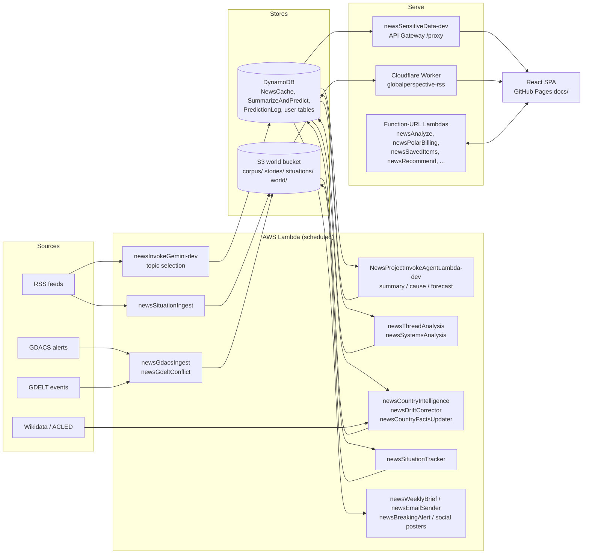

# Global Perspectives — Architecture

Last verified: 2026-10-19 (against repo code and read-only AWS ap-northeast-1).

This is the map, not the inventory. Every list of Lambdas, schedules, env keys, routes, feature folders
and S3 prefixes lives in `project-docs/reference/`, generated by `scripts/gen-reference.mjs` from the
code and live AWS. When this file and the reference disagree, the reference wins; when the reference
and live AWS disagree, re-run the generator. The previous long version is
`git show 120de90:project-docs/archive/architecture/ARCHITECTURE_2026-10-19_full.md` (deleted 2026-10-19) (history only; several of its facts
were wrong by 2026-10-19).

## Purpose

Global Perspectives (globalperspective.net) is an AI global-news intelligence site. Scheduled Lambdas
pull news (RSS) and hazard feeds (GDACS, GDELT), use an LLM to select and explain the stories that
matter, track situations on a world map, score country risk, make forecasts that are settled later in
public, and send a weekly brief. Reading is free and needs no account. A paid membership (Polar) buys
analysis compute in the Analysis Studio, not access to content.

## Bird's-eye view

Two stores, split by kind of data (`project-docs/rules/DATA_STRATEGY.md` holds the rules):
DynamoDB for the older topic/analysis pipeline and for per-user mutable records; the private S3
"world" bucket for everything the situation pipeline computes about the world. The browser never
talks to S3 directly — only through the Worker's `/data/*` route.

## Codemap

Paths are named, not linked; search for them.

### Backend — `backend/<group>/<dir>/src/`

Lambdas are grouped by feature (decision 0024): `backend/<group>/<dir>/` with `src/`, `test/` and a
README. Three still sit in the historical `amplify/backend/function/` folder: `newsAnalyze` and
`newsPolarBilling` (billing; moving them needs an operator yes) and `NewsProjectInvokeAgentLambda`.
Nothing is deployed with Amplify. Each Lambda is deployed by hand (see Deploy below).
`scripts/functions.json` maps each deployed name to its repo dir (`dir`, relative to the repo root;
every tool reads it from there), runtime, feature group and schedules. Names that surprise:

- `newsInvokeGemini` (deployed `newsInvokeGemini-dev`) — topic selection. Despite the name it calls
  DeepSeek, not Gemini.
- `NewsProjectInvokeAgentLambda` (deployed `-dev`), `newsSensitiveData` (deployed `-dev`) — the `-dev`
  suffix is production.
- `newsPostLinkedIn` deploys as `newsPostLinkedin` (lower-case "in").
- The Scheduler entry for country intelligence is named `countryIntelliegence` (typo is real).
- `amplify/backend/function/_sandbox/` holds the deploy script for the `-sandbox` twins of `newsAnalyze` and `newsPolarBilling`
  (no repo src of their own).
- `newsAnalyze/deployed-snapshot/` is a copy of what actually runs; `newsAnalyze/src/` is not it.

Feature groups (from functions.json): `pipeline` (selection, analysis, country risk), `situations`
(map pipeline), `predictions`, `distribution` (email, social), `read-api` (proxy and Function-URL
endpoints), `membership-studio` (Studio, billing), `monitoring`, `economy-parked`.

**Invariant:** code shared between Lambdas lives once, in `backend/shared/src/` (`llm.js` —
the one LLM client and `[usage]` cost line; `placeFilter.js`, `dayZero.js`, `riskDimensions.js`,
`situations-core.js`). Each consumer reaches it through a committed `src/_shared` symlink;
`scripts/lambda.sh` copies the real files into the zip. Never copy these into a Lambda.

### Frontend — `global-perspectives-starter/frontend/`

React + Vite SPA. Build output goes to the repo-root `docs/`.

- `src/app/` — routing (`App.jsx`), the redirects for retired URLs (`LegacyRedirects.jsx`,
  `MapRedirect.jsx`), layout/chrome (`layout/`), the error boundary (`errors/`).
- `src/features/<name>/` — 13 feature folders, each owning its pages, components, hooks and lib.
  `map` owns `/` (the situation console), `home` owns `/today`, `threads` owns `/weekly` and thread
  pages, `countries` owns country pages, `analysis-studio` owns `/analyze`. `/weekly`'s Countries
  section is `countries`' `CountryListPage`, handed to `WeeklyPage` by `App.jsx` as its
  `countriesView` prop so `threads` never imports `countries`. Full table:
  `project-docs/reference/features.md`; every route: `project-docs/reference/routes.md`.
- `src/features/<name>/index.js` — a feature's public API: only what other features and `app/`
  import (hooks, helpers, the few embedded components). Route pages are not in it: `App.jsx`
  lazy-loads them by path so each stays its own chunk. `account`, `daily` and `static` have no
  `index.js` (nothing outside them imports them).
- `src/shared/` — cross-feature code: `api/restProxy.js` (the one client for the proxy and the
  Function-URL endpoints), `contexts/AuthContext.jsx`, `styles/tokens.css` + `styles/tokens.js`,
  `lib/` (pure helpers such as `riskTiers.js`, `situationLabels.js`, `questionChips.js`),
  `hooks/` (data hooks several features read: `useDailyBrief`, `useMembership`, `usePreferences`,
  `useSavedItems`, `useDisruptionsList`), `ui/` (shared blocks, boot loader, `BottomSheet`, the
  Save / Follow / Subscribe controls, `deck.css` — the slide-deck shell of story, Studio and briefing
  mode), `map/` (the map drawing kit: `RadarMap`, `SituationMap3D`, `StoryMap`, `mapKit.css`, their
  pure libs and the topojson asset).
- `worker/` + `wrangler.jsonc` — the Workers Static Assets site (`globalperspective-site`), prepared
  but not the production path yet.
- `eslint.config.js`, `vite.config.js` — the import rules below.

**Invariant:** imports flow `app → features → shared`. ESLint `no-restricted-imports` fails a
`shared/` file that imports `@/features` or `@/app`, and a `features/` file that imports `@/app`.
Another feature (or `app/`) is imported only through its index (`@/features/<name>`); eslint fails
a static import of a file inside another feature (tests and lazy `import()` are exempt).
Feature-to-feature imports are allowed but must not form a cycle: `quality/check_feature_cycles.mjs`
(run by pre-commit with the other `quality/check_*.mjs`) fails on any feature↔feature cycle or any
`shared → features` import.

**Invariant:** imports inside `src/` use the `@/` alias (`vite.config.js`: `@` → `src`). The
exceptions are the few files that Node tooling outside `src/` imports by relative path; they carry a
header comment saying so.

### Edge — `cloudflare/front-worker/`

`production/worker.mjs` is the repo copy of the `globalperspective-rss` Worker that fronts production;
`baseline/worker2.mjs` is the captured deployed source; `candidate.mjs` wraps it for
`next.globalperspective.net`. The Worker: SigV4-signs GETs to the private S3 world bucket for
`/data/*` (only `world/`, `situations/state/`, `stories/state/` JSON keys), proxies `/rss` to the
proxy's `rss` action, pre-renders pages for bot user-agents, and returns the SPA shell with a 200 for
other GET paths.

### Operator tools

- `scripts/` — `lambda.sh` (diff/package/deploy/rollback one Lambda, driven by functions.json),
  `audit-lambda-drift.sh` (read-only: diff every deployed zip against the repo), `gen-reference.mjs`,
  `errors.mjs` (reads the client-error table and maps minified stacks back to source),
  `smoke-test.mjs`, `link-crawl.mjs`, `auth-guard-check.mjs`, `contract-check.mjs`,
  `situations-log.mjs`.
- `quality/` — the frontend verify gate (`verify_pages.sh`, ratchets such as
  `check_color_literals.mjs`, `check_shared_blocks.mjs`), eval harnesses.
- `predictions/` — `settle-review.js` (the human confirm step for forecast verdicts),
  `verify-draw.mjs`, older pilot scripts.
- `backend/<group>/cli/` — operator review/send CLIs next to their Lambdas: `distribution/cli/breaking/`
  (`review.js`, `send.js`, `send-test.js`), `distribution/cli/weekly/review.js`,
  `economy-parked/cli/weekly-markets/review.js`.
- `deploy.sh` (repo root) — frontend verify/build/package and release targets.

## Data flows

Times are UTC unless noted; exact cron expressions and ENABLED/DISABLED state are in
`project-docs/reference/schedules.md`.

### 1. Topic selection and daily stories (DynamoDB)

1. `newsInvokeGemini-dev` (three times a day) reads 26 RSS feeds, asks the LLM to pick and cluster the
   day's topics, and writes them to DynamoDB `NewsCache` item `id='staging'`. It also writes a raw
   capture of what it saw to S3 `audit/ingest-capture/` (read by the selection shadow and the parked
   impact audit). Brave search is no longer used in ingest.
2. `NewsProjectInvokeAgentLambda-dev` (10 minutes later) reads `staging`, writes a summary, cause
   trace and forecast per topic to `SummarizeAndPredict` (`TOPIC#…` keys), logs each forecast to
   `GlobalPerspectivePredictionLog`, assigns thread ids (writing `threads/story-map.json` to S3 by
   matching against `stories/state/`), then swaps `staging` → `latest` and updates the archive.
3. `newsThreadAnalysis` (daily) writes per-thread analysis and dated history
   (`THREAD#…` / `THREAD_ANALYSIS`, `THREAD_HISTORY#<date>`); `newsSystemsAnalysis` (daily) reads those
   and writes causal webs (`SYSTEMS#…`, `WEB#INDEX`, `THREAD#…/WEB`).
4. `newsSelectionShadow` runs a candidate layered selector (corpus + GDACS, scored by an external
   model "Jev") against what was published and writes only `audit/selection-shadow/`. Nothing on the
   site reads it.

The site reads all of this through `newsSensitiveData-dev`.

### 2. Situations and the map (S3)

1. `newsGdacsIngest` (every 20 min, no LLM) reads the GDACS feed and overwrites the Orange/Red
   observations to `situations/inbox/gdacs-latest.json` and the full snapshot to
   `corpus/gdacs/latest.json`. It is the only inbox opener; the per-event append inbox was never built.
2. `newsGdeltConflict` (every 6 h, no LLM) writes conflict events to `corpus/gdelt/<day>.json`; only
   the impact audit reads them, and it is parked.
3. `newsSituationIngest` (hourly) reads RSS, classifies each headline with the LLM (country, location,
   axis, severity; cached in `stories/classify-cache.json`), clusters deterministically, and writes
   `corpus/<date>/<hour>.jsonl`, `stories/state/`, `stories/index.json`.
4. `newsSituationTracker` (every 30 min, no LLM) is the only writer of `situations/` state and
   `world/`: it folds the inbox, stories and the thread story-map into `situations/state/`,
   `situations/index.json`, `situations/history/`, closed situations into `situations/archive/`, and
   assembles `world/latest.json` (+ dated snapshots and `world/latest.member.json`).
5. The map feature fetches `/data/world/latest.json` and `/data/situations/state/<id>.json`
   (`src/features/map/api/worldData.js`) through the Worker.

**Invariant:** each S3 prefix has one writer (`DATA_STRATEGY.md`). Add a writer only by changing that
table first.

**Invariant:** `*.member.json` is never served. The Worker's member check is a stub that always
refuses, so any key containing `.member.` returns 401 until a real JWT check exists.

**Invariant:** `signals/` is built by `newsSignals` and served only by its own key-gated Function URL —
never added to the Worker's `/data/*` allow-list.

### 3. Forecasts and the track record

Forecasts are written by the agent Lambda (step 1.2) to `GlobalPerspectivePredictionLog`.
`newsPredictionResolver` (daily tick; unparked, decision 0027) commits a weekly random seed, draws a sample of questions, and on
Mondays asks the LLM to draft verdicts; it never sees the forecast probability. Nothing is final until
the operator confirms each draft with `predictions/settle-review.js`. Records are write-once
(conditional puts). `newsPredictionsSnapshot` (every 30 min) scans the log into
`predictions/track_record.json`; the proxy action `prediction_track_record` serves that file
(falling back to a live scan only if it is missing) to `/track-record`.

### 4. Country risk and living analysis

`newsCountryFactsUpdater` (weekly, Mondays JST) writes current facts from Wikidata and ACLED to
`FACTS#<country>`. `newsCountryIntelligence` (daily) reads thread analyses and facts, and
writes `COUNTRY#<name>` / `COUNTRY_INTELLIGENCE` plus a dated `HISTORY#<date>` snapshot.
`newsDriftCorrector` (daily) compares snapshots; when a risk level, score (|Δ| ≥ 8) or trajectory
moves, it grounds the move in a real archived event and writes a note (`DRIFT#<date>` with a 60-day
TTL, permanent `DRIFTLOG#<date>`). The original analysis is never overwritten. Brave news grounding
is coded in `newsCountryIntelligence`, `newsThreadAnalysis` and the agent Lambda but off live: none has
`BRAVE_SEARCH_API_KEY` set (checked 2026-10-19).

Risk tiers are 0–24 low, 25–49 moderate, 50–74 elevated, 75–100 high: `src/shared/lib/riskTiers.js`
on the frontend, `tierFromScore` in `riskDimensions.js` on the backend.

**Invariant:** a risk tier is never a traffic-light colour. Risk shows as a number, a tier word and a
ring weight; the `--tier-*` tokens are neutral greys that get brighter with the tier, and `TierChip`
has no fill. `quality/verify_pages.sh` fails if a `--tier-*` token gets a hue or `TierChip.css` gets a
background.

### 5. Email and distribution

- Weekly brief: `newsWeeklyBrief` (Sunday) writes `WEEKLY_BRIEF#<week>` to `SummarizeAndPredict`,
  published directly. `newsEmailSender` mode `weekly` (Sunday, later) sends it with Resend to
  subscribers in `GlobalPerspectiveUserPrefs` (`digestOptIn`), logging each week so it is never sent
  twice. Its `breaking` and `drift_alert` rules are DISABLED.
- `newsBreakingAlert` (every 8 h) scores stories deterministically, records proposals in
  `GlobalPerspectiveBreakingAlerts`, and with live `DRY_RUN=false` emails each detection to a single
  operator address. It does not email subscribers.
- `newsPostDevTo` publishes a daily brief to dev.to; `newsPostLinkedin` posts to LinkedIn. Both log to
  `NewsProject-linkedin-posts`.
- Subscription preferences and unsubscribe go through `newsRecommend` (Function URL).

**Invariant:** user-facing sends are switched on only by the operator. A disabled email rule stays
disabled until an explicit decision.

### 6. Analysis Studio (`/analyze`)

Two paths to the same lenses (`scenario`, `whatchanged`, `economic`, `compare`; prompts in
`src/features/analysis-studio/lib/analysisPrompt.js`):

- Bring-your-own-key: the key stays in the browser (localStorage) and the browser calls the provider
  directly (`lib/llm.js`, `lib/byok.js`). No server is involved.
- Member path: `restProxy.js` `runMemberAnalysis` posts to `newsAnalyze` (Function URL, auth in code)
  with the Firebase ID token. The deployed code requires `tier === 'member'` and applies a per-user
  daily cap (`ANALYZE_DAILY_CAP`).

`newsSharedAnalysis` stores share links in `GlobalPerspectiveShares` (create needs a JWT; read by id
is public, `noindex`); they render at `/analyze/s/:id`.

**Invariant:** the deployed `newsAnalyze` differs from `newsAnalyze/src/` (the repo carries parked
credits code). Never deploy the repo file over it without a fresh go-live decision; `lambda.sh`
refuses functions marked `deployBlocked` in functions.json.

### 7. Billing (Polar)

`newsPolarBilling` (Function URL) has three paths: the Polar webhook (Standard Webhooks signature),
`create_checkout` and `get_membership` (both need a Firebase JWT). The webhook writes `tier`,
`subscriptionStatus` and `billingProvider='polar'` onto the user's row in `GlobalPerspectiveUserTable`.
`/membership` and `/account` read it back through `get_membership`. Credit packs are parked: the code
path exists, but the live function has no `POLAR_CREDIT_PACKS` key.

## Cross-cutting concerns

### Auth

Firebase Authentication in the browser (`src/shared/contexts/AuthContext.jsx`: email magic link and
Google). `App.jsx` wires `getIdToken` into `restProxy.js` (`setAuthProvider`), which sends
`Authorization: Bearer <id token>`. Lambdas that need identity verify the token themselves (fetch
Google's securetoken certs, check RS256 and the issuer for `FIREBASE_PROJECT_ID`): `newsAnalyze`,
`newsPolarBilling`, `newsSavedItems`, `newsRecommend`, `newsSensitiveData`, `newsSharedAnalysis`.

**Invariant:** public data never needs sign-in. No proxy action requires auth; `newsSensitiveData`
only reads the tier best-effort (falling back to `free`) to shorten two member extras
(`country_history` drift notes, `corrections_feed`). Frontend data hooks must not gate on `user`;
membership limits are enforced server-side.

### Runtime config

`docs/config.js` is operator-owned and loaded at runtime; it sets `window.*` endpoints and keys
(`SENSITIVE_PROXY_ENDPOINT`, `NEWS_ANALYZE_ENDPOINT`, `NEWS_SHARE_ENDPOINT`, `POLAR_BILLING_ENDPOINT`,
`SAVED_ITEMS_ENDPOINT`, `USER_PREFS_ENDPOINT`, `CLIENT_ERRORS_ENDPOINT`, `FIREBASE_CONFIG`,
`GOOGLE_MAPS_API_KEY`). None of these is bundled into the build. Local dev uses
`frontend/public/config.js` (template `public/config.example.js`).

### Endpoints and CORS

`newsSensitiveData-dev` is behind API Gateway (REST API `NewsSensitiveProxyRestAPI`, `GET`/`POST
/proxy`) and dispatches on `action`. The other browser-facing Lambdas use Function URLs (list:
`project-docs/reference/lambdas.md`).

**Invariant:** a Function URL gets CORS from exactly one place. If the code emits
`Access-Control-Allow-Origin` (`newsPolarBilling`, `newsAnalyze`, `newsSharedAnalysis`), the
Function-URL CORS config stays empty; if it does not (`newsSavedItems`, `newsRecommend`,
`newsClientErrors`), the Function-URL CORS config must be populated. Both at once sends a duplicate
header and the browser fails with "Failed to fetch". Grep the source before touching either side.

### LLM providers

Every LLM-calling pipeline Lambda checked on 2026-10-19 calls DeepSeek (`api.deepseek.com`); the
model is the live env value (`GROK_MODEL`; `PREDICTION_MODEL` on the agent Lambda; `AUDIT_MODEL` on
`newsSourceAudit`).
`newsSelectionShadow` is the exception (external "Jev" scorer). Studio BYOK calls whatever provider
the user picks.

**Invariant:** env names lie. `GROK_*` and `XAI_*` keys hold DeepSeek settings; read the live value
(`aws lambda get-function-configuration`), never infer the provider from the name or the Lambda's
name.

### Cost and usage logs

There is no central cost store. Every caller of `backend/shared/src/llm.js` (`newsInvokeGemini`,
`newsThreadAnalysis`, `newsSystemsAnalysis`, `newsCountryIntelligence`, `newsDriftCorrector`,
`newsWeeklyBrief`, `newsPostDevTo`, `newsSituationIngest`, `newsSensitiveData`, `newsSourceAudit`,
`newsImpactAudit`, `newsPredictionResolver`) plus `NewsProjectInvokeAgentLambda` and
`newsSelectionShadow` `console.log` a `[usage]` JSON line (function, step, model, token usage) into
CloudWatch Logs. `newsModelGuard` turns a measured daily burn into a balance-runway alert; nothing
else computes dollars. `newsAnalyze` logs no usage.

### Monitoring

Passive monitors publish to SNS `GlobalPerspectiveAlerts` (email subscription):

- `newsFreshnessMonitor` — proxy reachable and topics fresh (doubles as uptime check).
- `newsErrorDigest` — new or spiking browser errors from `GlobalPerspectiveClientErrors`, which
  `newsClientErrors` (public Function URL) fills from `window` error reports.
- `newsModelGuard` — any Lambda env pointing at a DeepSeek model that is deprecated or missing from
  DeepSeek's `/models`.
- `newsSourceAudit` (Mon/Wed/Fri) — our summaries drifting from their source articles.
- `newsImpactAudit` — high-impact events the selection missed (its rule is currently DISABLED).

Active checks are run by hand: `scripts/smoke-test.mjs`, `link-crawl.mjs`, `auth-guard-check.mjs`,
`contract-check.mjs`, `scripts/errors.mjs`. There is no CI by design (solo developer).

### Deploy

- Frontend: `./deploy.sh` with no target verifies, builds and packages locally, nothing more.
  `--target candidate|production` uploads to the Cloudflare site Worker; `--target legacy-pages` runs
  the GitHub Pages release (production today). Each upload target needs explicit operator approval.
  Details: `project-docs/runbooks/DEPLOYMENT_NOTES.md`.
- Lambdas: `scripts/lambda.sh <name> diff|package|deploy|rollback` packages
  `<dir>/src` from functions.json (no node_modules, no tests), refuses to deploy over deployed
  files it cannot find in git unless forced, backs up first, and refuses `deployBlocked` functions.
  `scripts/audit-lambda-drift.sh` is the read-only fleet-wide diff.
- Worker: code-only updates through the Cloudflare API that keep its routes, bindings and secrets
  (see `cloudflare/front-worker/README.md`); never a bare `wrangler deploy`.

**Invariant:** `docs/` is build output. Never hand-edit it; change `global-perspectives-starter/frontend/src`
and rebuild. `docs/config.js` is the one operator-owned file in it.

**Invariant:** the deployed zip may differ from the repo. Diff first (`scripts/lambda.sh <name> diff`
or `scripts/audit-lambda-drift.sh`) before editing or deploying any Lambda.

**Invariant:** environment variables are a second deploy surface. Features turn on and off by env
alone (for example `DRY_RUN` on `newsBreakingAlert`, credit packs on `newsPolarBilling`). When
changing env, fetch the full map, merge, and write it back whole.

## Deliberately absent

- No read paywall: content is free; membership buys Studio compute.
- No Amplify, no CI, no secrets manager (Lambda env holds secrets by choice).
- No direct browser access to S3, and no public bucket.
- Economy is parked (decision 0009): `newsEconomicImpact`, `newsEconomicQuality`, `newsWeeklyMarkets` and
  `newsPairIntelligence` rules are DISABLED and `/weekly-markets` redirects to `/briefings`. Still
  running: `newsMarketsData` (hourly/daily/weekly rules ENABLED) and the `/economy` route, which is
  reachable by URL though not in the nav.

## Reference (generated — re-run `node scripts/gen-reference.mjs`)

- `project-docs/reference/lambdas.md` — every Lambda: repo dir, runtime, group, triggers, deploy notes.
- `project-docs/reference/schedules.md` — every EventBridge rule and Scheduler schedule, with state.
- `project-docs/reference/env-keys.md` — env key names per Lambda and drift against the source.
- `project-docs/reference/routes.md` — every frontend route and redirect.
- `project-docs/reference/features.md` — feature folders and their routes.
- `project-docs/reference/s3-prefixes.md` — world-bucket prefixes from code, live S3 and DATA_STRATEGY.
- DynamoDB tables in use: `NewsCache`, `SummarizeAndPredict`, `GlobalPerspectivePredictionLog`,
  `GlobalPerspectiveUserTable`, `GlobalPerspectiveUserPrefs`, `GlobalPerspectiveSavedItems`,
  `GlobalPerspectiveShares`, `GlobalPerspectiveBreakingAlerts`, `GlobalPerspectiveClientErrors`,
  `GlobalPerspectiveApiKeys`, `GlobalPerspectiveMarkets`, `NewsProject-linkedin-posts`. Storage
  rules: `project-docs/rules/DATA_STRATEGY.md`.
