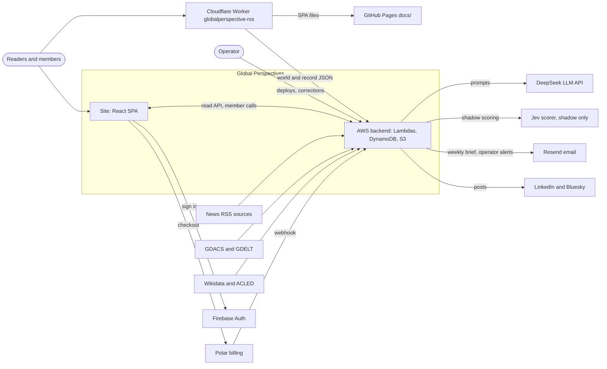
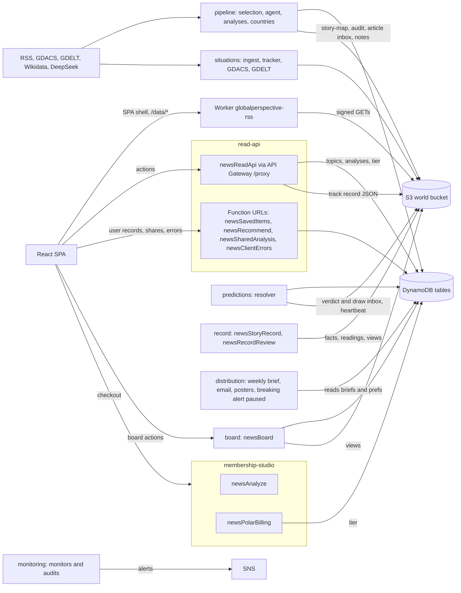
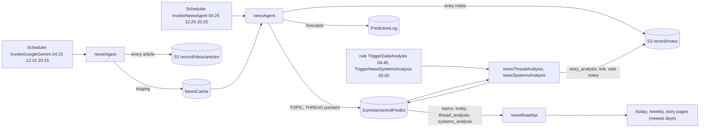
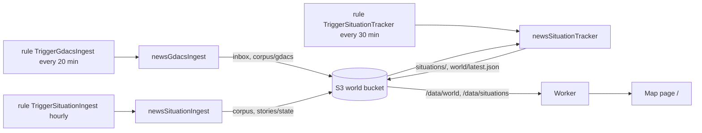
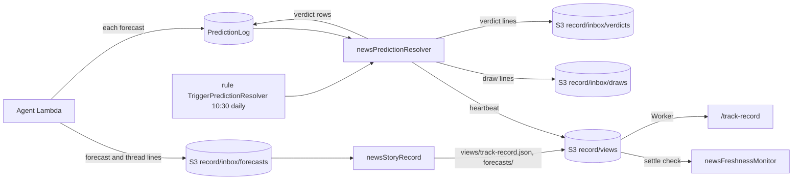
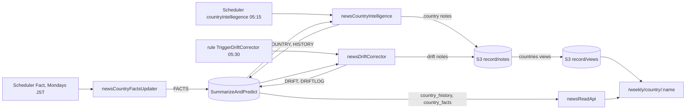
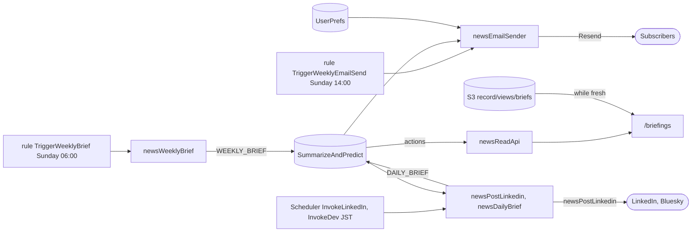

# Global Perspectives: Architecture

This is the map, not the inventory. Lambdas, schedules, env keys, routes, feature folders and S3 prefixes are read from the source of truth: `scripts/functions.json`, `aws lambda list-functions`, `aws events list-rules`, `aws scheduler list-schedules`, `src/app/App.jsx`, `ls src/features`, `aws s3 ls`. When this file and those disagree, they win. Area designs: [the record](ARCHITECTURE_TIMELINE.md), [forecast loop](ARCHITECTURE_FORECAST_LOOP.md), [weekly review](ARCHITECTURE_WEEKLY_REVIEW.md), [board](ARCHITECTURE_BOARD.md), [storage rules](DATA_STRATEGY.md), [world model](WORLD_MODEL.md). What is stopped or waiting right now: `project-docs/START_HERE.md`.

The live frontend is the build in `docs/` (the bundle `docs/index.html` names); a change in `src/` reaches the site only through a release. That build already has decisions 0048 to 0050 (briefs page on the record, economy removed, views-freshness rule).

## Purpose
Global Perspectives (globalperspective.net) is an AI global-news intelligence site. Scheduled Lambdas pull news (RSS) and hazard feeds (GDACS, GDELT), use an LLM to select and explain the stories that matter, track situations on a world map, score country risk, make forecasts that are settled later in public, and send a weekly brief. Reading is free and needs no account. A paid membership (Polar) buys following countries and deeper history, not access to content.

The site's memory is the record: an append-only set of facts, readings and notes in S3 (decision 0035). Pages read static views built from it. The older DynamoDB world tables are still live and still read for what no view holds yet; step 5 retires them.

## Bird's-eye view
### Context

Every Lambda that calls an LLM uses `api.deepseek.com` through the live env value (`GROK_MODEL`, `PREDICTION_MODEL`, `REVIEW_MODEL`). Each job's model is chosen by a recorded Flash-versus-Pro test (decision 0056). Live 2026-11-04: `newsRecordReview`, `newsSystemsAnalysis`, `newsDailyBrief`, `newsIngest`, `newsAgent` summaries and the other analysis Lambdas run `deepseek-flash`; `newsCountryIntelligence`, `newsWeeklyBrief`, `newsAgent` forecasts (`PREDICTION_MODEL`) and parked `newsAnalyze` run `deepseek-v4-pro`. The exception is `newsSelectionShadow`, which calls the external Jev scorer. The weekly email rule (`TriggerWeeklyEmailSend`) is ENABLED with `EMAIL_SEND_DRY_RUN=false`; the breaking and drift email rules are DISABLED; `newsPostLinkedin` (every 3 hours, JST) and `newsDailyBrief` (daily 23:00 JST) are ENABLED.

### Containers

Two stores, split by kind of data ([DATA_STRATEGY.md](DATA_STRATEGY.md) holds the rules). DynamoDB holds per-user mutable records, a few operational tables, and the older world tables (`NewsCache`, `SummarizeAndPredict`, the `PRED#` rows of `GlobalPerspectivePredictionLog`) that step 5 retires (decision 0035; scope and order in [STEP5_AUDIT.md](STEP5_AUDIT.md)). The private S3 "world" bucket holds everything computed about the world, the record included. Pages read the record's views first, through the Worker, and fall back to the read proxy's actions for what a view does not hold yet. The browser never talks to S3 directly, only through the Worker's `/data/*` route.

## Codemap
Paths are named, not linked; search for them.

### Backend: `backend/<group>/<dir>/src/`
Lambdas are grouped by feature (decision 0024): `backend/<group>/<dir>/` with `src/`, `test/` and a README. The group list, what each Lambda is for and how a Lambda folder is laid out are in [backend/README.md](../../backend/README.md); `scripts/functions.json` maps each deployed name to its repo dir, runtime, group and schedules. Nothing is deployed with Amplify. Folder and deployed name differ for `newsIngest` (dir `newsInvokeGemini`), `newsAgent` (dir `NewsProjectInvokeAgentLambda`), `newsDailyBrief` (dir `newsPostDevTo`) and `newsReadApi` (dir `newsSensitiveData`), renamed 2026-11-03/04. The old-name functions `NewsProjectInvokeAgentLambda-dev` and `newsInvokeGemini-dev` were deleted 2026-11-05; `newsPostDevTo` and `newsSensitiveData-dev` still exist, unscheduled and deploy-blocked, until the operator deletes them; `newsPostLinkedIn` deploys as `newsPostLinkedin`; the Scheduler entry for country intelligence is named `countryIntelliegence` (the typo is real). `backend/membership-studio/_sandbox/` holds the deploy script for the `-sandbox` twins of `newsAnalyze` and `newsPolarBilling`; `newsAnalyze/deployed-snapshot/` is what actually runs, `newsAnalyze/src/` is not.

**Invariant:** code shared between Lambdas lives once, in `backend/shared/src/` (see its README). Each consumer reaches it through a committed `src/_shared` symlink; `scripts/lambda.sh` copies the real files into the zip. Never copy these into a Lambda.

Country names are canonical at the writers (United States, DR Congo, UAE; `resolveIso3`), so one country is one record; briefs, forecasts, drift notes and shares carry related ids (`iso3[]`, `threadId`).

### Frontend: `global-perspectives-starter/frontend/`
React + Vite SPA. Build output goes to the repo-root `docs/`.
- `src/app/`: routing (`App.jsx`), redirects for retired URLs, layout and chrome, the error boundary.
- `src/features/<name>/`: 12 feature folders (`account`, `analysis-studio`, `board`, `breaking`, `briefings`, `countries`, `home`, `map`, `ops`, `static`, `threads`, `track-record`), each owning its pages, components, hooks and lib. `map` owns `/`, `home` owns `/today`, `threads` owns `/weekly` and the story pages, `countries` the country pages, `board` `/board`, `ops` `/ops` (the operator's page, noindex, the nav link only after the `ops` action answers 200), `briefings` `/briefings`, `track-record` `/track-record`, `analysis-studio` only the shared-run page `/analyze/s/:id` (`/analyze` is a redirect in `app/`). `/weekly`'s Countries tab links to `/weekly/countries`, which `App.jsx` routes to `countries`' `CountryListPage`, so `threads` never imports `countries`. Routes: `App.jsx`.
- `src/features/<name>/index.js`: a feature's public API, only what other features and `app/` import (route pages are not in it; `App.jsx` lazy-loads them by path). `account`, `analysis-studio`, `static` and `weekly` have none.
- `src/shared/`: `api/` (`restProxy.js` the one client for the proxy and the Function-URL endpoints; `recordViews.js` the one reader of `/data/record/views/`; `viewsFresh.js` the 9-hour freshness rule; the per-view readers), `contexts/AuthContext.jsx`, `styles/` tokens, `lib/` pure helpers, `hooks/` shared data hooks, `ui/` shared blocks, `map/` the map drawing kit.
- `worker/` + `wrangler.jsonc`: the Workers Static Assets site (`globalperspective-site`), prepared but not the production path.

**Invariant:** imports flow `app -> features -> shared`. ESLint `no-restricted-imports` fails a `shared/` file that imports `@/features` or `@/app`, and a `features/` file that imports `@/app`. Another feature is imported only through its index (`@/features/<name>`); tests and lazy `import()` are exempt. Feature-to-feature imports must not form a cycle (`quality/check_feature_cycles.mjs`, run by pre-commit with the other `quality/check_*.mjs`).

**Invariant:** imports inside `src/` use the `@/` alias. The exceptions are the few files that Node tooling outside `src/` imports by relative path; they carry a header comment saying so.

### Edge: `cloudflare/front-worker/`
The repo copy of the `globalperspective-rss` Worker that fronts production (`production/worker.mjs`), the captured baseline and the candidate wrapper. What it serves (the `/data/*` allow-list, `/rss`, redirects, bot pre-render, the SPA fallback) is in [cloudflare/front-worker/README.md](../../cloudflare/front-worker/README.md).

### Operator tools
- `scripts/`: `lambda.sh` (diff, package, deploy, rollback one Lambda, driven by functions.json), `audit-lambda-drift.sh`, `errors.mjs`, `gen-pipeline-blocks.mjs`, and on-demand checks (`smoke-test.mjs`, `link-crawl.mjs`, `auth-guard-check.mjs`, `contract-check.mjs`, `situations-log.mjs`, `check-shared-sync.mjs`).
- `quality/`: the frontend verify gate (`verify_pages.sh` and ratchets such as `check_color_literals.mjs`, `check_shared_blocks.mjs`, `check_docs.mjs`, `check_links.mjs`), eval harnesses.
- `predictions/`: `settle-correct.js` (list settled and due questions; correct a verdict with a reason), `verify-draw.mjs`.
- `backend/<group>/cli/`: operator CLIs next to their Lambdas: `distribution/cli/`, `pipeline/cli/threads.mjs` (list-joins, merge, split; print-only without `--apply`), `record/cli/` (note backfills, the history copy, day recovery, actor reconciliation, assignment benchmark).
- `deploy.sh` (repo root): frontend verify, build, package and release targets.

## Data flows
Times are UTC unless noted; exact cron expressions and ENABLED/DISABLED state come from `aws events list-rules` and `aws scheduler list-schedules`. Per-Lambda triggers, reads and writes are in each Lambda's README; the record's own writers and readers are in [ARCHITECTURE_TIMELINE.md](ARCHITECTURE_TIMELINE.md) section 6.

### 1. Topic selection and daily stories (DynamoDB)

`newsIngest` (three times a day) picks and clusters the day's topics with the LLM and stages them in `NewsCache`, after writing every fetched article raw to `record/inbox/articles/` (decision 0040). Ten minutes later `newsAgent` writes each topic's summary, cause trace and forecast to `SummarizeAndPredict`, assigns story (`threadId`) ids, logs the forecast and writes the entry notes; `newsThreadAnalysis` and `newsSystemsAnalysis` then write per-story analysis and causal webs, as DynamoDB rows and as notes. `newsSelectionShadow` (`TriggerSelectionShadow`, 04:20/12:20/20:20, ENABLED) scores a candidate selector with the external "Jev" model and writes only `audit/selection-shadow/`; nothing reads it, and whether it continues is an operator decision. Detail: [backend/pipeline/README.md](../../backend/pipeline/README.md). The record's views carry the entries, analyses and links these produce; `newsReadApi` still answers what the views do not hold (today's topics, the home map's topic card, the board's pin titles, member extras).

### 2. Situations and the map (S3)

No LLM except the headline classifier in `newsSituationIngest`. `newsGdacsIngest` is the only writer of the situations inbox; `newsGdeltConflict` writes `corpus/gdelt/` and nothing reads it since 2026-11-01; `newsSituationTracker` is the only writer of `situations/` state and `world/`. The map fetches `/data/world/latest.json` and `/data/situations/state/<id>.json` through the Worker. Detail: [backend/situations/README.md](../../backend/situations/README.md).

**Invariant:** each S3 prefix has one writer (DATA_STRATEGY.md §4). Add a writer only by changing that table first.

**Invariant:** `*.member.json` is never served. The Worker's member check is a stub that always refuses, so any key containing `.member.` returns 401 until a real JWT check exists.

### 3. Forecasts and the track record

The agent logs each forecast to `GlobalPerspectivePredictionLog` and to `record/inbox/forecasts/`. `newsPredictionResolver` runs the forecast loop (decision 0038): nightly verdicts from the record's own facts, a weekly committed random draw of 22 pre-registered questions that the public track record scores, and (decision 0055) sampled questions checked first, with "record gap" voids counted apart. `newsStoryRecord` turns verdict and draw lines into facts and builds `record/views/track-record.json`, which the track-record page reads with no fallback (decision 0044). The commitment state (`SEED#`, `SAMPLE#`, `Q#`, `SETTLE#`) stays in the prediction log. Yes, no and void verdicts are final at once (decision 0034); the operator appends a correction with `predictions/settle-correct.js`. Design and constants: [ARCHITECTURE_FORECAST_LOOP.md](ARCHITECTURE_FORECAST_LOOP.md); Lambda detail: [backend/predictions/README.md](../../backend/predictions/README.md). The snapshot path (`newsPredictionsSnapshot`, the `prediction_snapshot` and `prediction_track_record` actions) was removed 2026-11-01.

### 4. Country risk and living analysis

`newsCountryFactsUpdater` (weekly) writes Wikidata and ACLED facts; `newsCountryIntelligence` (daily) writes each country's analysis and a dated history; `newsDriftCorrector` (daily) grounds any move in tier, score or trajectory in a real archived event and writes a note. The original analysis is never overwritten, and no pipeline Lambda runs a web search. The country pages read the country views; member drift depth, country facts and the corrections ledger stay on the proxy actions. Detail: [backend/pipeline/README.md](../../backend/pipeline/README.md).

Risk tiers are 0-24 low, 25-49 moderate, 50-74 elevated, 75-100 high: `src/shared/lib/riskTiers.js` on the frontend, `tierFromScore` in `backend/shared/src/riskDimensions.js` on the backend (`world/tier.js` wraps it).

**Invariant:** a risk tier is never a traffic-light colour. Risk shows as a number, a tier word and a ring weight; the `--tier-*` tokens are neutral greys that get brighter with the tier, and `TierChip` has no fill. `quality/verify_pages.sh` fails if a `--tier-*` token gets a hue or `TierChip.css` gets a background.

### 5. Briefs, email and distribution

`newsWeeklyBrief` (Sunday 06:00) and `newsDailyBrief` (daily, JST) write the briefs to DynamoDB and, since decision 0048, as `daily_brief` / `weekly_brief` notes into the record; `newsStoryRecord` builds the brief views, which `/briefings`, the Worker's bot pre-render and the email sender read first (decision 0054), falling back to the DynamoDB rows. `newsEmailSender` weekly mode (Sunday 14:00) sends through Resend to subscribers with `digestOptIn`, logging each week so it is never sent twice; its `breaking` and `drift_alert` rules are DISABLED. Breaking alerts are paused (operator, 2026-11-06, for a redesign): `newsBreakingAlert` has `DRY_RUN=true` and its rule `TriggerBreakingAlert` is DISABLED. Before the pause it emailed each detection to one operator address only (7 proposals, none confirmed), and an alert shows on the site only after the operator confirms it (`review.js`); the bell and strip are being unmounted in a frontend change that is not released yet. Subscriber breaking and drift emails stay DISABLED, and the weekly email is unchanged. Alerts are separate from verdicts, which have no human gate. `newsPostLinkedin` posts to LinkedIn and Bluesky. Detail: [backend/distribution/README.md](../../backend/distribution/README.md).

**Invariant:** user-facing sends are switched on only by the operator. A disabled email rule stays disabled until an explicit decision.

### 6. Analysis Studio (retired) and the country sheet
The lens Studio is gone from the site (decisions 0030, 0033). `/analyze?stories=<id,...>` redirects to the first id's story page when it is a thread id (`thread-...`), otherwise to the countries list (`app/LegacyRedirects.jsx`; the front Worker sends the same as a real 301 and never bot-renders `/analyze/s/*`). Kept:
- Shared-run pages: `newsSharedAnalysis` still serves shares from `GlobalPerspectiveShares` (read by id is public, `noindex`); the SPA renders them at `/analyze/s/:id` so links already out there work. The site can no longer create a share.
- `newsAnalyze` and the prompt, validator and context libraries in `src/features/analysis-studio/lib/`: no page calls them; the share Lambda copies some (checked by `scripts/check-shared-sync.mjs`) and the offline eval harness in `quality/analysis/` imports them.
- The country page (`/weekly/country/:countryName`) is the "sheet": fact and judgment marks on every section, a computed "What we don't know", Copy as text, Print and a private "Your view". It reads stored data only; no model runs on view.

**Invariant:** the deployed `newsAnalyze` differs from `newsAnalyze/src/` (the repo carries parked credits code). Never deploy the repo file over it without a fresh go-live decision; `lambda.sh` refuses functions marked `deployBlocked` in functions.json.

### 7. Billing (Polar)
`newsPolarBilling` (Function URL): the Polar webhook, `create_checkout` and `get_membership` write and read `tier` and `subscriptionStatus` on the user's row in `GlobalPerspectiveUserTable`. Credit packs are parked (decision 0002). Detail: [its README](../../backend/membership-studio/newsPolarBilling/README.md).

### 8. The record
The site's memory is one append-only record in the world bucket (`record/`): **facts** (what happened, appended nightly with no model by `newsStoryRecord`, from 2026-03-07 after the history copy of decision 0047), **readings** (what it meant, written weekly with hindsight by `newsRecordReview`, citing facts), **notes** (what a model wrote about something the record names, one writer per subtype through shared `notes.js`, decision 0042) and **views** (rebuilt from the three by `newsStoryRecord`, the only builder; served through the Worker at `/data/record/views/`; rebuilt after every ingest and brief, decision 0050, with today's entries as provisional until the nightly run). Nothing is edited in place. Other writers never write facts: they append to inboxes that `newsStoryRecord` converts. Pages read the views first and keep the old action as a fallback when `manifest.json` `builtAt` is over 9 hours old or a view does not hold the answer (`shared/api/viewsFresh.js`); the remaining readers and what step 5 waits on are in [STEP5_AUDIT.md](STEP5_AUDIT.md). The board (`newsBoard`) keeps boards in `GlobalPerspectiveSavedItems` as `board#<id>` and reads the views.

Design, ten stages, object model and open items: [ARCHITECTURE_TIMELINE.md](ARCHITECTURE_TIMELINE.md). Decisions 0035 to 0054: [decisions/README.md](../decisions/README.md). Rebuild test: `backend/record/newsStoryRecord/scripts/rebuild-test.js`.

## Links, identity and product rules
### One link system
Every reader destination has one canonical address built by one module (`shared/lib/links.js`, backend mirror `backend/shared/src/links.js` for emails, guarded by `scripts/check-shared-sync.mjs` and the `check_links.mjs` ratchet). `<EntityLink kind id>` in `shared/ui` renders the link and hover preview. Pages never build paths by hand.

| Entity | Key | Address |
|---|---|---|
| Story | `threadId` (stable; topic ids change every run) | `/weekly/thread/:threadId` |
| Country | ISO3 | `/weekly/country/:displayName` (the page resolves aliases and codes and redirects to the canonical name) |
| Situation | situation id (country + thread) | `/?focus=<id>`; no thread: link its country |
| Map focus | story / country | `/?story=<threadId>`, `/?country=<ISO3>` |
| Forecast | `qid` | `/track-record?q=<qid>`, inline `#q-<qid>` on the story page |
| Briefing | date / week | `/briefings?date=YYYY-MM-DD`, `/briefings?mode=weekly&week=YYYY-MM-DD`; old `/daily`, `/weekly-brief` get real 301s from the Worker |

Country identity: one source, `backend/shared/src/iso3Names.json` (`{name, aliases[]}`), one resolver `resolveCountry(text) -> {iso3, name} | null`. Display names are short ("UAE", "DR Congo"). Non-countries (Strait of Hormuz, West Bank) are plain text; a place inside one country links to that country.

### Hosting and the Cloudflare cutover
Production is the GitHub Pages `docs/` build behind the Cloudflare `globalperspective-rss` Worker. The decision is to go ahead with Workers Static Assets in a second Worker (decision [0019](../decisions/0019-frontend-hosting-two-worker-cloudflare.md), operator confirmed 2026-10-20); the site Worker is prepared locally and not cut over, and live DNS steps come to the operator first. What is recorded only here:
- Candidate checks run on `workers.dev` and then on a test hostname (proposed `next.globalperspective.net`) that exercises the front-Worker chain: RSS, bot HTML, `/data/*`, all eight blog URLs, noindex. A narrow `/blog` passthrough in the front Worker is a separate reviewed change that must keep the RSS, bot, `/data/*`, S3-secret and member branches unchanged.
- Two fallbacks during the observation window (default 48 hours plus one verified release before retiring Pages; never retire automatically): every release goes to both the new Worker and Pages, and the last artifact that passed its post-deploy checks is kept with commit, hash and Worker version. A Cloudflare rollback restores a Worker version and its assets, not DNS, deleted secrets, changed bindings or data.
- Cutover steps and their reversal come from the account's captured DNS, TLS and ruleset state, never from guesses. Sign-in, API CORS and the Maps referrer must be verified on the test hostname or waived explicitly. `docs/config.js` already sets `BOARD_ENDPOINT`; add it to `REQUIRED_CONFIG_FIELDS` in `scripts/prepare-site-assets.mjs` at cutover.
- Each of these needs a fresh operator yes: candidate upload, front-Worker patch, test hostname, Firebase authorized domain, the cutover, every production release, retiring Pages. Worker details: [cloudflare/front-worker/README.md](../../cloudflare/front-worker/README.md).

## Cross-cutting concerns
### Auth
Firebase Authentication in the browser (`src/shared/contexts/AuthContext.jsx`: email magic link and Google). `App.jsx` wires `getIdToken` into `restProxy.js` (`setAuthProvider`), which sends `Authorization: Bearer <id token>`. Lambdas that need identity verify the token themselves (Google's securetoken certs, RS256, issuer for `FIREBASE_PROJECT_ID`): `newsAnalyze`, `newsPolarBilling`, `newsSavedItems`, `newsRecommend`, `newsSensitiveData`, `newsSharedAnalysis`, `newsBoard`.

**Invariant:** public data never needs sign-in. No proxy action requires auth; `newsReadApi` only reads the tier best-effort (falling back to `free`) to shorten two member extras (`country_history` drift notes, `corrections_feed`). Record views carry no member data: the country view holds only the newest drift note. Frontend data hooks must not gate on `user`; membership limits are enforced server-side.

### Runtime config
`docs/config.js` is operator-owned and loaded at runtime; it sets the `window.*` endpoints and keys (proxy, share, billing, saved items, prefs, client errors, board, `FIREBASE_CONFIG`, `GOOGLE_MAPS_API_KEY`). None is bundled into the build. Local dev uses `frontend/public/config.js` (template `public/config.example.js`).

### Endpoints and CORS
`newsReadApi` is behind API Gateway (REST API `NewsSensitiveProxyRestAPI`, `GET`/`POST /proxy`) and dispatches on `action`. The other browser-facing Lambdas use Function URLs (list: `scripts/functions.json`).

**Invariant:** a Function URL gets CORS from exactly one place. If the code emits `Access-Control-Allow-Origin` (`newsPolarBilling`, `newsAnalyze`, `newsSharedAnalysis`), the Function-URL CORS config stays empty; if it does not (`newsSavedItems`, `newsRecommend`, `newsClientErrors`, `newsBoard`), the config must be populated. Both at once sends a duplicate header and the browser fails with "Failed to fetch". Grep the source before touching either side.

### LLM providers
Every LLM-calling Lambda calls DeepSeek (`api.deepseek.com`) through shared `llm.js` or its own client; the model is the live env value (job-by-job list: [COSTS.md](COSTS.md) section 4). `newsSelectionShadow` is the exception (external "Jev" scorer).

**Invariant:** env names lie. `GROK_*` and `XAI_*` keys hold DeepSeek settings; read the live value (`aws lambda get-function-configuration`), never infer the provider from the name.

### Cost and usage logs
There is no central cost store. Callers of `backend/shared/src/llm.js`, `newsAgent` and `newsSelectionShadow` `console.log` a `[usage]` JSON line (function, step, model, tokens) into CloudWatch Logs. `newsModelGuard` turns a fixed daily-burn constant (`DAILY_BURN_USD`, measured once from these logs on 2026-10-18) into a runway estimate in its balance alert; `newsAnalyze` logs no usage.

### Monitoring
Alert email goes through SNS `GlobalPerspectiveAlerts`, and the operator cut it back on 2026-11-06 because `/ops` shows the same facts: `newsModelGuard` (DeepSeek balance, retired model ids) is the one email kept; `newsFreshnessMonitor` still publishes (rule ENABLED) and is to be disabled once `HEAL=on` (planned, not done); `newsErrorDigest` is DISABLED (the Quality panel's client-errors check replaces it); `newsSourceAudit` still runs and logs but has no `SNS_TOPIC_ARN`, so it emails nothing. What each watches is in [backend/monitoring/README.md](../../backend/monitoring/README.md). `newsHealth` (live since 2026-11-04; hourly, no model, no alerts) writes the public pipeline panel `record/views/health.json` and the private money panel `monitoring/ops.json`, which only `newsReadApi` action `ops` serves, to the uids in `OPS_OPERATOR_UIDS` ([ARCHITECTURE_OPS.md](ARCHITECTURE_OPS.md)). With `HEAL=on` it also re-runs a missing day's agent once and, failing that, invokes the unscheduled `newsRecover` (group `record`, deployed 2026-11-06; rebuilds the day's raw articles from GDELT and Wayback, no model); `HEAL` is `dry` for now (to be set `on` after the first dry tick is reviewed; planned 2026-11-06).

Global Perspectives has no CloudWatch alarms (read live with `aws cloudwatch describe-alarms`): the per-function, proxy, DynamoDB and situation-tracker alarms were removed 2026-11-02 to 2026-11-04 by the operator, who does not want pipeline alarms for the record, the review or LLM 402 / insufficient balance. Do not propose them. Billing: `AWS-Bill-Over-5-Dollars` (us-east-1) and budget `Monthly-AWS-Budget` ($20) notify by email. `PPA*`, `ppa-*` and `so-v3-engine` alarms and `ppa-alerts` belong to other projects in the account. Known behaviour: stages swallow LLM errors, so Lambda `Errors` can stay 0; expected refusals (LinkedIn `429 share limit`, "no new topics") count as errors. Capacity, IAM or code changes are operator-asked work (CLAUDE.md, Authorization). Active checks (the `scripts/` list above) are run by hand; there is no CI by design.

### Deploy
- Frontend: `./deploy.sh` with no target verifies, builds and packages locally, nothing more. `--target candidate|production` uploads to the Cloudflare site Worker; `--target legacy-pages` runs the GitHub Pages release (production today). Each upload target needs explicit operator approval. Details: `.claude/skills/deploy-frontend/DEPLOYMENT_NOTES.md`.
- Lambdas: `scripts/lambda.sh <name> diff|package|deploy|rollback` packages `<dir>/src` from functions.json (no node_modules unless the live zip ships them, no tests), refuses to deploy over deployed files it cannot find in git unless forced, backs up first, and refuses `deployBlocked` functions. `scripts/audit-lambda-drift.sh` is the read-only fleet-wide diff.
- Worker: code-only updates through the Cloudflare API that keep its routes, bindings and secrets (see `cloudflare/front-worker/README.md`); never a bare `wrangler deploy`.

**Invariant:** `docs/` is build output. Never hand-edit it; change `global-perspectives-starter/frontend/src` and rebuild. `docs/config.js` is the one operator-owned file in it.

**Invariant:** the deployed zip may differ from the repo. Diff first before editing or deploying any Lambda.

**Invariant:** environment variables are a second deploy surface. Features turn on and off by env alone (for example `DRY_RUN` on `newsBreakingAlert`, `NOTES_PREFIX` on the note writers, `REVIEW_CONCURRENCY` on the review). When changing env, fetch the full map, merge, and write it back whole.

## Deliberately absent
- No read paywall: content is free; membership buys following countries and deeper history.
- No Amplify, no CI, no secrets manager (Lambda env holds secrets by choice).
- No direct browser access to S3, and no public bucket.
- No economy product (decision 0049): no `/economy` route, tab, FX box or markets read actions; `GlobalPerspectiveMarkets` is deleted. What remains is data with no writer, the `ECON#THREAD#`, `PAIR#` and `WEEKLY_MARKETS#` rows in `SummarizeAndPredict` (backup under `backup/economy-2026-10-31/`); they go on an operator yes.

## Tables and storage
DynamoDB holds the user tables, a few operational tables (`GlobalPerspectiveBreakingAlerts`, `GlobalPerspectiveClientErrors`, `NewsProject-linkedin-posts`, the `EMAILLOG#` rows) and the commitment state in `GlobalPerspectivePredictionLog`; those stay. The world tables (`NewsCache`, `SummarizeAndPredict`, the `PRED#` rows) are still live and read until step 5 retires them; `GlobalPerspectiveMarkets` was deleted 2026-11-01. The private S3 world bucket holds everything computed about the world. Rules and prefix owners: [DATA_STRATEGY.md](DATA_STRATEGY.md); per-table fate and order: [STEP5_AUDIT.md](STEP5_AUDIT.md).
