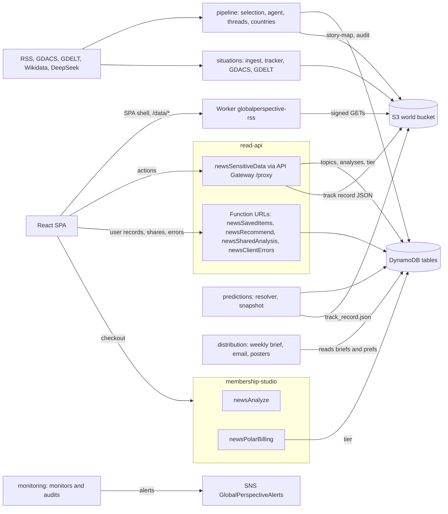
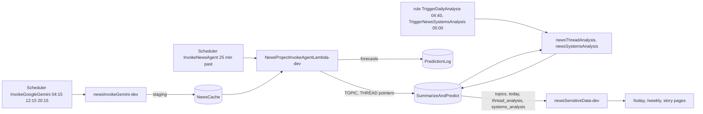
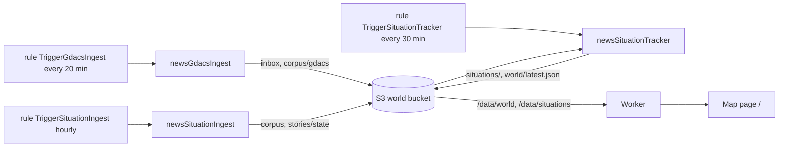
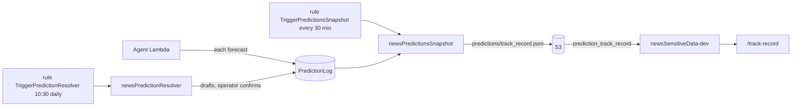
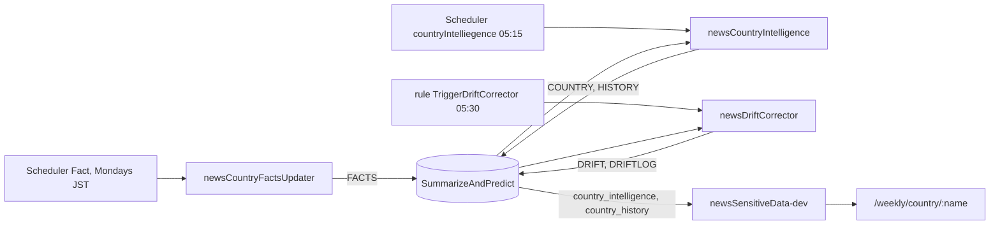
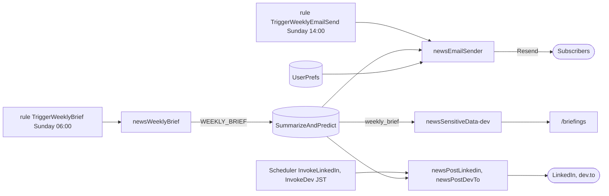
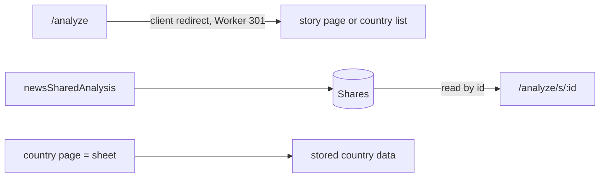
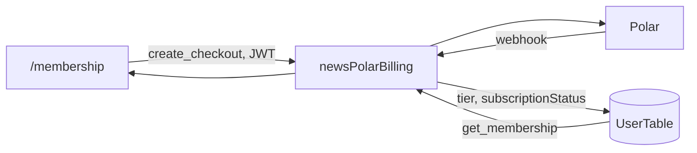

# Global Perspectives — Architecture

Last verified: 2026-10-23 (against repo code and read-only AWS ap-northeast-1; the record section, flows 1 and 3 and the Worker allow-list were re-checked that day, the rest 2026-10-20).
This is the map, not the inventory. Lambdas, schedules, env keys, routes, feature folders and S3 prefixes
are read from the source of truth: `scripts/functions.json` and `aws lambda list-functions`, `aws events
list-rules` and `aws scheduler list-schedules`, `src/app/App.jsx`, `ls src/features`, `aws s3 ls`. When this
file and those disagree, they win. Area designs: [the record](ARCHITECTURE_TIMELINE.md), [forecast
loop](ARCHITECTURE_FORECAST_LOOP.md), [weekly review and analyst weekly](ARCHITECTURE_WEEKLY_REVIEW.md),
[board](ARCHITECTURE_BOARD.md), [ingest proposal](ARCHITECTURE_INGEST_DESIGN.md), [storage rules](DATA_STRATEGY.md),
[world model](WORLD_MODEL.md).

## Purpose

Global Perspectives (globalperspective.net) is an AI global-news intelligence site. Scheduled Lambdas
pull news (RSS) and hazard feeds (GDACS, GDELT), use an LLM to select and explain the stories that
matter, track situations on a world map, score country risk, make forecasts that are settled later in
public, and send a weekly brief. Reading is free and needs no account. A paid membership (Polar) buys
following countries and deeper history (the Analysis Studio retired 2026-10-20), not access to content.

## Bird's-eye view

### Context: who and what the system touches

Live on 2026-10-20: every pipeline Lambda that calls an LLM uses `api.deepseek.com` (`deepseek-v4-pro`
or `deepseek-flash`, from `GROK_MODEL` / `PREDICTION_MODEL`); the weekly email rule
(`TriggerWeeklyEmailSend`) is ENABLED and `EMAIL_SEND_DRY_RUN=false`; the breaking and drift email rules are
DISABLED; `newsPostLinkedin` (every 3 h, JST) and `newsPostDevTo` (daily, JST) are ENABLED.

### Containers: what runs and what it exchanges

Two stores, split by kind of data ([DATA_STRATEGY.md](DATA_STRATEGY.md) holds the rules):
DynamoDB for the older topic/analysis pipeline and for per-user mutable records; the private S3
"world" bucket for everything the situation pipeline computes about the world. The browser never
talks to S3 directly — only through the Worker's `/data/*` route.

## Codemap

Paths are named, not linked; search for them.

### Backend — `backend/<group>/<dir>/src/`

Lambdas are grouped by feature (decision 0024): `backend/<group>/<dir>/` with `src/`, `test/` and a
README; the last three left the historical `amplify/` folder on 2026-10-19 (operator decision).
Nothing is deployed with Amplify. Each Lambda is deployed by hand (see Deploy below).
`scripts/functions.json` maps each deployed name to its repo dir (`dir`, relative to the repo root;
every tool reads it from there), runtime, feature group and schedules. Names that surprise:

- Country names are canonical at the writers (United States, DR Congo, UAE; `resolveIso3` in
  `backend/shared/src/`), so one country is one record; briefs, signals, forecasts, drift notes and
  shares carry related ids (`iso3[]`, `threadId`).
- `newsInvokeGemini` (deployed `newsInvokeGemini-dev`) — topic selection. Despite the name it calls
  DeepSeek, not Gemini.
- `NewsProjectInvokeAgentLambda` (deployed `-dev`), `newsSensitiveData` (deployed `-dev`) — the `-dev`
  suffix is production.
- `newsPostLinkedIn` deploys as `newsPostLinkedin` (lower-case "in").
- The Scheduler entry for country intelligence is named `countryIntelliegence` (typo is real).
- `backend/membership-studio/_sandbox/` holds the deploy script for the `-sandbox` twins of `newsAnalyze` and `newsPolarBilling`
  (no repo src of their own).
- `newsAnalyze/deployed-snapshot/` is what actually runs; `newsAnalyze/src/` is not.

Feature groups (from functions.json): `pipeline` (selection, analysis, country risk), `situations`
(map pipeline), `predictions`, `record` (`newsStoryRecord`, the facts writer), `board` (`newsBoard`), `distribution` (email, social), `read-api` (proxy and Function-URL
endpoints), `membership-studio` (billing, and `newsAnalyze`, which the site no longer calls), `monitoring`, `economy-parked`. `backend/weekly/` (the analyst's weekly) holds schema and model only, no Lambda yet.

**Invariant:** code shared between Lambdas lives once, in `backend/shared/src/` (`llm.js` —
the one LLM client and `[usage]` cost line; `placeFilter.js`, `resolveIso3.js` (canonical country names),
`dayZero.js`, `riskDimensions.js`, `situations-core.js`). Each consumer reaches it through a committed `src/_shared` symlink;
`scripts/lambda.sh` copies the real files into the zip. Never copy these into a Lambda.

### Frontend — `global-perspectives-starter/frontend/`

React + Vite SPA. Build output goes to the repo-root `docs/`.

- `src/app/` — routing (`App.jsx`), redirects for retired URLs, layout/chrome, the error boundary.
- `src/features/<name>/` — 13 feature folders, each owning its pages, components, hooks and lib. `map` owns
  `/`, `home` owns `/today`, `threads` owns `/weekly` and thread pages, `countries` owns country pages,
  `analysis-studio` owns only the shared-run page `/analyze/s/:id`; `/analyze` itself is a redirect in `app/`. `/weekly`'s Countries section is
  `countries`' `CountryListPage`, handed to `WeeklyPage` by `App.jsx` as a prop so `threads` never imports
  `countries`. Routes: `App.jsx`; features: `ls src/features`.
- `src/features/<name>/index.js` — a feature's public API: only what other features and `app/` import.
  Route pages are not in it: `App.jsx` lazy-loads them by path. `account`, `daily` and `static` have no
  `index.js`.
- `src/shared/` — cross-feature code: `api/restProxy.js` (the one client for the proxy and the Function-URL
  endpoints), `contexts/AuthContext.jsx`, `styles/` tokens, `lib/` pure helpers, `hooks/` shared data hooks,
  `ui/` shared blocks, `map/` the map drawing kit.
- `worker/` + `wrangler.jsonc` — the Workers Static Assets site (`globalperspective-site`), prepared
  but not the production path yet.
- `eslint.config.js`, `vite.config.js` — the import rules below.

**Invariant:** imports flow `app → features → shared`. ESLint `no-restricted-imports` fails a
`shared/` file that imports `@/features` or `@/app`, and a `features/` file that imports `@/app`.
Another feature (or `app/`) is imported only through its index (`@/features/<name>`); eslint fails
a static import of a file inside another feature (tests and lazy `import()` are exempt).
Feature-to-feature imports are allowed but must not form a cycle: `quality/check_feature_cycles.mjs`
(run by pre-commit with the other `quality/check_*.mjs`) fails on any feature↔feature cycle or any
`shared → features` import.

**Invariant:** imports inside `src/` use the `@/` alias (`vite.config.js`: `@` → `src`). The
exceptions are the few files that Node tooling outside `src/` imports by relative path; they carry a
header comment saying so.

### Edge — `cloudflare/front-worker/`

`production/worker.mjs` is the repo copy of the `globalperspective-rss` Worker that fronts production;
`baseline/worker2.mjs` is the captured deployed source; `candidate.mjs` wraps it for
`next.globalperspective.net`. The Worker: SigV4-signs GETs to the private S3 world bucket for
`/data/*` (JSON keys under `world/`, `situations/state/`, `stories/state/` and `record/views/`, never facts, runs or readings; live version `1e17cf9a`), proxies `/rss` to the
proxy's `rss` action, pre-renders pages for bot user-agents, and returns the SPA shell with a 200 for
other GET paths.

### Operator tools

- `scripts/` — `lambda.sh` (diff/package/deploy/rollback one Lambda, driven by functions.json),
  `audit-lambda-drift.sh`, `errors.mjs`, and on-demand checks (`smoke-test.mjs`,
  `link-crawl.mjs`, `auth-guard-check.mjs`, `contract-check.mjs`, `situations-log.mjs`).
- `quality/` — the frontend verify gate (`verify_pages.sh`, ratchets such as
  `check_color_literals.mjs`, `check_shared_blocks.mjs`), eval harnesses.
- `predictions/` — `settle-correct.js` (list settled/due questions; correct a verdict with a reason), `verify-draw.mjs`.
- `backend/<group>/cli/` — operator CLIs next to their Lambdas: `distribution/cli/` (breaking and weekly
  review/send), `pipeline/cli/threads.mjs` (list-joins / merge / split thread joins; print-only without
  `--apply`), `economy-parked/cli/`.
- `deploy.sh` (repo root) — frontend verify/build/package and release targets.

## Data flows

Times are UTC unless noted; exact cron expressions and ENABLED/DISABLED state come from
`aws events list-rules` and `aws scheduler list-schedules`.

### 1. Topic selection and daily stories (DynamoDB)

1. `newsInvokeGemini-dev` (three times a day) reads 26 RSS feeds (fetches up to 25 items per feed, puts 8 per feed in
   the prompt), asks the LLM to pick and cluster the day's topics under the done-not-said rule, with code dedupe and a
   significance floor (decision 0040), and writes them to DynamoDB `NewsCache` item `id='staging'`. Before the model
   call it writes every fetched article to S3 `record/inbox/articles/` (raw capture, no model), so a model outage
   cannot lose the news; `newsStoryRecord` turns those lines into `article` facts. It also writes a capture to S3
   `audit/ingest-capture/` (read by the selection shadow and the parked impact audit). No web search in ingest.
2. `NewsProjectInvokeAgentLambda-dev` (10 minutes later) reads `staging`, writes a summary, cause
   trace and forecast per topic to `SummarizeAndPredict` (`TOPIC#…` keys, each carrying `threadId`), logs
   each forecast to `GlobalPerspectivePredictionLog`, assigns thread ids (writing `threads/story-map.json`
   to S3 by matching against `stories/state/`; a topic joins a thread only at composite score >= 0.4 *and*
   keyword overlap >= 0.15, each join logged as `[join]`; repair with `backend/pipeline/cli/threads.mjs`),
   then swaps `staging` → `latest`, updates the archive and
   writes the thread → topic pointer `THREAD#<threadId>` / `TOPICS` (current `topicId`, all `topicIds`).
3. `newsThreadAnalysis` (daily) writes per-thread analysis and dated history
   (`THREAD#…` / `THREAD_ANALYSIS`, `THREAD_HISTORY#<date>`); `newsSystemsAnalysis` (daily) reads those
   and writes causal webs (`SYSTEMS#…`, `WEB#INDEX`, `THREAD#…/WEB`), plus a daily snapshot to `web/YYYY/MM/DD.json` + `web/latest.json` in the world bucket.
4. `newsSelectionShadow` runs a candidate layered selector (corpus + GDACS, scored by an external
   model "Jev") against what was published and writes only `audit/selection-shadow/`. Nothing on the
   site reads it.

The site reads all of this through `newsSensitiveData-dev`.

### 2. Situations and the map (S3)

1. `newsGdacsIngest` (every 20 min, no LLM) reads the GDACS feed and overwrites the Orange/Red
   observations to `situations/inbox/gdacs-latest.json` and the full snapshot to
   `corpus/gdacs/latest.json`. It is the only inbox opener; the per-event append inbox was never built.
2. `newsGdeltConflict` (every 6 h, no LLM) writes conflict events to `corpus/gdelt/<day>.json`; only
   the impact audit reads them, and it is parked.
3. `newsSituationIngest` (hourly) reads RSS, classifies each headline with the LLM (country, location,
   axis, severity; cached in `stories/classify-cache.json`), clusters deterministically, and writes
   `corpus/<date>/<hour>.jsonl`, `stories/state/`, `stories/index.json`.
4. `newsSituationTracker` (every 30 min, no LLM) is the only writer of `situations/` state and
   `world/`: it folds the inbox, stories and the thread story-map into `situations/state/`,
   `situations/index.json` (news situations keyed `news#<ISO3>#<threadId>`, old per-story ids kept as
   `aliases`), `situations/history/`, closed situations into `situations/archive/`, and
   assembles `world/latest.json` (+ dated snapshots and `world/latest.member.json`).
5. The map feature fetches `/data/world/latest.json` and `/data/situations/state/<id>.json`
   (`src/features/map/api/worldData.js`) through the Worker.

**Invariant:** each S3 prefix has one writer (`DATA_STRATEGY.md`). Add a writer only by changing that
table first.

**Invariant:** `*.member.json` is never served. The Worker's member check is a stub that always
refuses, so any key containing `.member.` returns 401 until a real JWT check exists.

**Invariant:** `signals/` is built by `newsSignals` and served only by its own key-gated Function URL —
never added to the Worker's `/data/*` allow-list. The Signals API is parked (decisions/0032): no keys
issued, no page reads it, `TriggerSignalsBuild` is DISABLED; the code stays.

### 3. Forecasts and the track record

Forecasts are written by the agent Lambda (step 1.2) to `GlobalPerspectivePredictionLog`; it reconciles each `PRED#`
row to the entry's final `threadId` after the archive write, so a forecast never points at a thread the archive lacks.
`newsPredictionResolver` (daily tick; unparked, decision 0027) commits a weekly random seed, draws a sample of questions, and on
Mondays asks the LLM to draft verdicts and writes them; it never sees the forecast probability. Yes/no/void drafts become the
verdict at once (decision 0034); the operator can append a correction with `predictions/settle-correct.js`. Records are write-once
(conditional puts). The forecast loop (decision 0038, `ARCHITECTURE_FORECAST_LOOP.md`) replaces the Monday sample as the main
path: watch from the record, judge on the story's own entries after the draw (no web search), hand verdicts to
`newsStoryRecord` through the S3 inbox `record/inbox/verdicts/`. That resolver code is merged, not deployed; the deployed
resolver still drafts on Mondays. `newsPredictionsSnapshot` (every 30 min) scans the log into
`predictions/track_record.json`; the proxy action `prediction_track_record` serves that file
(falling back to a live scan only if it is missing) to `/track-record`.

### 4. Country risk and living analysis

`newsCountryFactsUpdater` (weekly, Mondays JST) writes current facts from Wikidata and ACLED to
`FACTS#<country>`. `newsCountryIntelligence` (daily) reads thread analyses and facts, and
writes `COUNTRY#<name>` / `COUNTRY_INTELLIGENCE` plus a dated `HISTORY#<date>` snapshot.
`newsDriftCorrector` (daily) compares snapshots; when a risk level, score (|Δ| ≥ 8) or trajectory
moves, it grounds the move in a real archived event and writes a note (`DRIFT#<date>` with a 60-day
TTL, permanent `DRIFTLOG#<date>`). The original analysis is never overwritten. None of these, nor the agent Lambda, runs a web
search: their unkeyed Brave code was deleted 2026-10-19. Brave remains only in the deployed resolver (its merged code
has none) and the dormant `newsPairIntelligence`.

Risk tiers are 0–24 low, 25–49 moderate, 50–74 elevated, 75–100 high: `src/shared/lib/riskTiers.js`
on the frontend, `tierFromScore` in `riskDimensions.js` on the backend.

**Invariant:** a risk tier is never a traffic-light colour. Risk shows as a number, a tier word and a
ring weight; the `--tier-*` tokens are neutral greys that get brighter with the tier, and `TierChip`
has no fill. `quality/verify_pages.sh` fails if a `--tier-*` token gets a hue or `TierChip.css` gets a
background.

### 5. Email and distribution

- Weekly brief: `newsWeeklyBrief` (Sunday) writes `WEEKLY_BRIEF#<week>` to `SummarizeAndPredict`,
  published directly. `newsEmailSender` mode `weekly` (Sunday, later) sends it with Resend to
  subscribers in `GlobalPerspectiveUserPrefs` (`digestOptIn`), logging each week so it is never sent
  twice. Its `breaking` and `drift_alert` rules are DISABLED.
- `newsBreakingAlert` (every 8 h) scores stories deterministically, records proposals in
  `GlobalPerspectiveBreakingAlerts`, and with live `DRY_RUN=false` emails each detection to a single
  operator address. It does not email subscribers.
- `newsPostDevTo` publishes a daily brief to dev.to; `newsPostLinkedin` posts to LinkedIn. Both log to
  `NewsProject-linkedin-posts`.
- Subscription preferences and unsubscribe go through `newsRecommend` (Function URL).

**Invariant:** user-facing sends are switched on only by the operator. A disabled email rule stays
disabled until an explicit decision.

### 6. Analysis Studio (retired 2026-10-20) and the country sheet

The lens Studio (pick stories, run a lens on the reader's own key or on `newsAnalyze`) is gone from the
site. `/analyze?stories=<id,...>` redirects to the first id's story page when it is a thread id
(`thread-...`), otherwise to the countries list (`app/LegacyRedirects.jsx`; the front Worker sends the same as a
real 301 and never bot-renders `/analyze/s/*`). Kept:

- Shared-run pages: `newsSharedAnalysis` still serves shares from `GlobalPerspectiveShares` (read by id is
  public, `noindex`); the SPA renders them at `/analyze/s/:id` so links already out there work. The site can
  no longer create a share.
- `newsAnalyze` and the prompt, validator and context libraries in `src/features/analysis-studio/lib/`: no page
  calls them; the share Lambda copies some (checked by `scripts/check-shared-sync.mjs`) and the offline eval
  harness in `quality/analysis/` imports them.
- The country page (`/weekly/country/:countryName`) is the "sheet": fact and judgment marks on every section,
  a computed "What we don't know", Copy as text, Print and a private "Your view". It reads stored data only; no
  model runs on view.

**Invariant:** the deployed `newsAnalyze` differs from `newsAnalyze/src/` (the repo carries parked
credits code). Never deploy the repo file over it without a fresh go-live decision; `lambda.sh`
refuses functions marked `deployBlocked` in functions.json.

### 7. Billing (Polar)

`newsPolarBilling` (Function URL) has three paths: the Polar webhook (Standard Webhooks signature),
`create_checkout` and `get_membership` (both need a Firebase JWT). The webhook writes `tier`,
`subscriptionStatus` and `billingProvider='polar'` onto the user's row in `GlobalPerspectiveUserTable`.
`/membership` and `/account` read it back through `get_membership`. Credit packs are parked: the code
path exists, but the live function has no `POLAR_CREDIT_PACKS` key.

### 8. The record (two clocks, decided 2026-10-21)

The site's memory is one append-only record in the world bucket (`record/`), written on two clocks. **Facts** (what
happened) are appended daily with no model by `newsStoryRecord` (`record/facts/YYYY-MM-DD.jsonl`). **Readings** (what it
meant) are written weekly, with hindsight, by `newsRecordReview` (`record/readings/YYYY-Www.jsonl`; merged, not created in
AWS), each reading citing facts and able to supersede an earlier one. Views under `record/views/` are rebuilt from both by
`newsStoryRecord`, the only builder; the weekly report (`weekly/`) is a view of the week's readings; the board and pages
read views through the Worker (`/data/record/views/`). Nothing is edited in place. Ten stages, object model, kinds, stores
and writers: `ARCHITECTURE_TIMELINE.md` (stage list as data: `pipeline.json`). Live state per stage comes from AWS; what is stopped or waiting is in `project-docs/START_HERE.md`.

Hand-off rule: other writers never write facts. The selector appends raw articles, the resolver verdicts, the review merges
and the operator assignments, splits and the who's who file (`record/operator/aliases.json`) to prefixes `newsStoryRecord`
reads; it converts them into facts and views. Stories keep `threadId`; an `assignment` fact moves an entry between stories
(latest wins); actors carry canonical `wd:Q...` ids once the who's who file names them, and generic actors never ground a
link. Board slice 1 (`/board`, `newsBoard` in `backend/board/`) keeps boards in `GlobalPerspectiveSavedItems` as
`board#<id>` and follows in `GlobalPerspectiveUserPrefs`, and reads the views.
Facts are the system of record, five stages, content IDs, rebuild test: decision `0035-facts-are-the-system-of-record.md`.

#### Foundation: facts are the system of record
Decision 0035: world data lives in `record/facts/` (S3, append-only); user data stays in DynamoDB; everything readers see
is a view rebuilt from facts and readings and served as static JSON through the Worker. Rebuild test: delete every view and
world row and the site rebuilds from `record/facts/` + `record/readings/`. Top-level stages, in order: **Ingest · Commit ·
Review · Build · Serve**; Watch is a rule (every run writes a Run object). Ingest and Commit are daily, Review is weekly,
Build follows each ingest and review, with no model. Raw before model (decision 0040): the selector captures articles
before the model call, the facts writer converts them, and stories are assignments over entries. Design and the ten-stage
mapping: `ARCHITECTURE_TIMELINE.md`; facts format `decisions/0036-facts-file-format.md`; views and serving
`decisions/0037-views-from-facts.md`; open items `ARCHITECTURE_TIMELINE.md` §7. The weekly review
(one call per active story, golden-week test): `ARCHITECTURE_WEEKLY_REVIEW.md`, decision 0039. The forecast loop (draw, watch,
gather, judge, record, review): `ARCHITECTURE_FORECAST_LOOP.md`, decision 0038.

## Links, identity and product rules

### One link system
Every reader destination has one canonical address built by one module (`shared/lib/links.js`, backend mirror
`backend/shared/src/links.js` for emails, guarded by `scripts/check-shared-sync.mjs` and the `check_links.mjs`
ratchet). `<EntityLink kind id>` in `shared/ui` renders the link and hover preview. Pages never build paths by hand.

| Entity | Key | Address |
|---|---|---|
| Story | `threadId` (stable; topic ids change every run, so a topic links to its thread) | `/weekly/thread/:threadId` |
| Country | ISO3 | `/weekly/country/:displayName` (URL keeps the display name; the page resolves aliases and codes and redirects to the canonical name) |
| Situation | situation id (keyed country + thread) | `/?focus=<id>`; no thread: link its country |
| Map focus | story / country | `/?story=<threadId>`, `/?country=<ISO3>` (`?story=` resolves any thread through `web_index.threads[threadId]`) |
| Forecast | `qid` | `/track-record?q=<qid>`, inline `#q-<qid>` on the story page |
| Briefing | date / week | `/briefings?date=YYYY-MM-DD`, `/briefings?mode=weekly&week=YYYY-MM-DD`; old `/daily`, `/weekly-brief` get real 301s from the Worker |

Country identity: one source, `backend/shared/src/iso3Names.json` (`{name, aliases[]}`), one resolver
`resolveCountry(text) -> {iso3, name} | null`; every other alias table is deleted. Display names are short ("UAE",
"DR Congo"). Non-countries (Strait of Hormuz, West Bank) are plain text; a place inside one country links to that
country. Duplicate country records merge under the canonical name; region records are retired. Join rule for
stories: keep a join at 0.4 similarity only with keyword overlap of at least 0.15, normalise titles, include
same-day generations, and log every join.

### Breaking alerts
A breaking alert shows on the site only when the operator has `confirmed` it; the operator email is marked
"[Unconfirmed] NOT PUBLIC YET" and carries the confirm command (`review.js`). This is separate from verdicts,
which have no human gate (0034). The country page is the country sheet (fact and judgment tags, "How it
connects", "What we don't know", no AI runs on view), see flow 6.

### Hosting and the Cloudflare cutover
Production is the GitHub Pages `docs/` build behind the Cloudflare `globalperspective-rss` Worker. The decision is to
go ahead with Workers Static Assets in a second Worker (decision 0019, operator confirmed 2026-10-20); live DNS steps
come to the operator first. The new site Worker is prepared locally and not cut over.
- Candidate checks run on `workers.dev` (site files only) and then on a test hostname (proposed
  `next.globalperspective.net`) that exercises the front-Worker chain: RSS, bot HTML, `/data/*`, all eight blog
  URLs, noindex. The front Worker currently returns the SPA shell for extensionless `/blog/*`; a narrow `/blog`
  passthrough there is a separate reviewed, separately approved change that must keep the RSS, bot, `/data/*`,
  S3-secret and member branches unchanged.
- Two fallbacks during the observation window (default 48 hours plus one verified release before retiring Pages;
  never retire automatically): the hosting fallback (every release goes to both the new Worker and Pages, so
  switching the domain back never serves an older build) and the release fallback (the last artifact that passed
  its post-deploy checks, with commit, hash and Worker version, so an app regression rolls back to it).
  A Cloudflare rollback restores a Worker version and its assets, not DNS, deleted secrets, changed bindings or data.
- Cutover steps and their reversal come from the account's captured DNS, TLS and ruleset state (the API token
  lacked those reads), never from guesses. Sign-in, API CORS (read APIs allow only the site origins) and the Maps
  referrer must be verified on the test hostname or waived explicitly.
- Each of these needs a fresh operator yes: candidate upload, front-Worker patch, test hostname, Firebase
  authorized domain, the cutover, every production release, retiring Pages.

## Cross-cutting concerns

### Auth

Firebase Authentication in the browser (`src/shared/contexts/AuthContext.jsx`: email magic link and
Google). `App.jsx` wires `getIdToken` into `restProxy.js` (`setAuthProvider`), which sends
`Authorization: Bearer <id token>`. Lambdas that need identity verify the token themselves (fetch
Google's securetoken certs, check RS256 and the issuer for `FIREBASE_PROJECT_ID`): `newsAnalyze`,
`newsPolarBilling`, `newsSavedItems`, `newsRecommend`, `newsSensitiveData`, `newsSharedAnalysis`.

**Invariant:** public data never needs sign-in. No proxy action requires auth; `newsSensitiveData`
only reads the tier best-effort (falling back to `free`) to shorten two member extras
(`country_history` drift notes, `corrections_feed`). Frontend data hooks must not gate on `user`;
membership limits are enforced server-side.

### Runtime config

`docs/config.js` is operator-owned and loaded at runtime; it sets the `window.*` endpoints and keys (proxy,
share, billing, saved items, prefs, client errors, `FIREBASE_CONFIG`, `GOOGLE_MAPS_API_KEY`). None is
bundled into the build. Local dev uses `frontend/public/config.js` (template `public/config.example.js`).

### Endpoints and CORS

`newsSensitiveData-dev` is behind API Gateway (REST API `NewsSensitiveProxyRestAPI`, `GET`/`POST
/proxy`) and dispatches on `action`. The other browser-facing Lambdas use Function URLs (list:
`scripts/functions.json`).

**Invariant:** a Function URL gets CORS from exactly one place. If the code emits
`Access-Control-Allow-Origin` (`newsPolarBilling`, `newsAnalyze`, `newsSharedAnalysis`), the
Function-URL CORS config stays empty; if it does not (`newsSavedItems`, `newsRecommend`,
`newsClientErrors`), the Function-URL CORS config must be populated. Both at once sends a duplicate
header and the browser fails with "Failed to fetch". Grep the source before touching either side.

### LLM providers

Every LLM-calling pipeline Lambda checked on 2026-10-19 calls DeepSeek (`api.deepseek.com`); the
model is the live env value (`GROK_MODEL`; `PREDICTION_MODEL` on the agent Lambda; `AUDIT_MODEL` on
`newsSourceAudit`).
`newsSelectionShadow` is the exception (external "Jev" scorer).

**Invariant:** env names lie. `GROK_*` and `XAI_*` keys hold DeepSeek settings; read the live value
(`aws lambda get-function-configuration`), never infer the provider from the name or the Lambda's
name.

### Cost and usage logs

There is no central cost store. Callers of `backend/shared/src/llm.js`, `NewsProjectInvokeAgentLambda` and
`newsSelectionShadow` `console.log` a `[usage]` JSON line (function, step, model, tokens) into CloudWatch
Logs. `newsModelGuard` turns the measured daily burn into a runway alert; `newsAnalyze` logs no usage.

### Monitoring

Passive monitors publish to SNS `GlobalPerspectiveAlerts` (email subscription): `newsFreshnessMonitor`
(proxy reachable, topics fresh), `newsErrorDigest` (new or spiking browser errors that `newsClientErrors`
collects in `GlobalPerspectiveClientErrors`), `newsModelGuard` (a Lambda env pointing at a deprecated
DeepSeek model, and balance runway), `newsSourceAudit` (Mon/Wed/Fri: summaries drifting from their sources)
and `newsImpactAudit` (rule DISABLED).

Alarm and notification topology (read live alarms with `aws cloudwatch describe-alarms`): two SNS topics with
near-identical names. `GlobalPerspectivesAlerts` (an AWS Chatbot subscription and one email) carries the Lambda
alarms (account-wide error spike, per-function errors on the pipeline and proxy Lambdas, proxy throttles and p99
duration, DynamoDB throttles on `NewsCache` and `SummarizeAndPredict`). `GlobalPerspectiveAlerts` (email only)
carries the monitor Lambdas and the situation-tracker alarms (`situation-tracker-errors`, and
`situation-tracker-stalled`, which fires when the `ChecksRun` metric stops, meaning `world/latest.json` stopped
updating). Billing: `AWS-Bill-Over-5-Dollars` (us-east-1) and budget `Monthly-AWS-Budget` ($20) notify by email.
`PPA*`, `ppa-*` alarms and budgets belong to another project in the account. Record and model alarms (2026-10-31, to `GlobalPerspectiveAlerts`):
`GP-LLM-InsufficientBalance` (metric filter `LlmInsufficientBalance` on the 13 active DeepSeek callers' log groups, namespace
`GlobalPerspective/Pipeline`; stages swallow LLM errors, so Lambda `Errors` alone stays 0), `GP-StoryRecord-Errors`,
`GP-StoryRecord-NotRun` (no invocation for 25 h) and `GP-RecordReview-Errors` (the review throws on a partial Run). Known gaps:
no alarm reads the record's Run objects themselves (an `ok` Run with `archiveDay: missing`);
expected refusals (LinkedIn `429 share limit`, "no new topics") count as errors; the monitors do not dedupe
(one mail on break, one on recovery). Open question: one topic or two. Capacity, IAM or code changes are
operator-asked work (CLAUDE.md, Authorization).

Active checks (the `scripts/` list above) are run by hand. There is no CI by design (solo developer).

### Deploy

- Frontend: `./deploy.sh` with no target verifies, builds and packages locally, nothing more.
  `--target candidate|production` uploads to the Cloudflare site Worker; `--target legacy-pages` runs
  the GitHub Pages release (production today). Each upload target needs explicit operator approval.
  Details: `.claude/skills/deploy-frontend/DEPLOYMENT_NOTES.md`.
- Lambdas: `scripts/lambda.sh <name> diff|package|deploy|rollback` packages
  `<dir>/src` from functions.json (no node_modules, no tests), refuses to deploy over deployed
  files it cannot find in git unless forced, backs up first, and refuses `deployBlocked` functions.
  `scripts/audit-lambda-drift.sh` is the read-only fleet-wide diff.
- Worker: code-only updates through the Cloudflare API that keep its routes, bindings and secrets
  (see `cloudflare/front-worker/README.md`); never a bare `wrangler deploy`.

**Invariant:** `docs/` is build output. Never hand-edit it; change `global-perspectives-starter/frontend/src`
and rebuild. `docs/config.js` is the one operator-owned file in it.

**Invariant:** the deployed zip may differ from the repo. Diff first (`scripts/lambda.sh <name> diff`
or `scripts/audit-lambda-drift.sh`) before editing or deploying any Lambda.

**Invariant:** environment variables are a second deploy surface. Features turn on and off by env
alone (for example `DRY_RUN` on `newsBreakingAlert`, credit packs on `newsPolarBilling`). When
changing env, fetch the full map, merge, and write it back whole.

## Deliberately absent

- No read paywall: content is free; membership buys following countries and deeper history.
- No Amplify, no CI, no secrets manager (Lambda env holds secrets by choice).
- No direct browser access to S3, and no public bucket.
- Economy is parked (decision 0009): `newsEconomicImpact`, `newsEconomicQuality`, `newsWeeklyMarkets` and
  `newsPairIntelligence` rules are DISABLED, `/weekly-markets` redirects to `/briefings`, links that
  dead-ended in economy are gone and the country FX box is labelled raw quotes (decision 0031). Still
  running: `newsMarketsData` (rules ENABLED) and the `/economy` route, reachable by URL though not in the nav.

## Tables and storage

DynamoDB tables in use: `NewsCache`, `SummarizeAndPredict`, `GlobalPerspectivePredictionLog`,
`GlobalPerspectiveUserTable`, `GlobalPerspectiveUserPrefs`, `GlobalPerspectiveSavedItems`,
`GlobalPerspectiveShares`, `GlobalPerspectiveBreakingAlerts`, `GlobalPerspectiveClientErrors`,
`GlobalPerspectiveApiKeys`, `GlobalPerspectiveMarkets`, `NewsProject-linkedin-posts`. Storage rules:
[DATA_STRATEGY.md](DATA_STRATEGY.md). Story-web history is kept daily in S3 (`web/YYYY/MM/DD.json`, IAM write on
`web/*` only).
