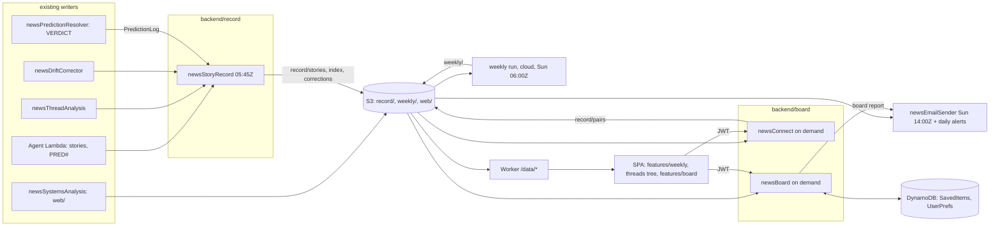

# The record subsystem: architecture

The model this subsystem implements is `ARCHITECTURE_TIMELINE.md`. **Revised 2026-10-21: two clocks.** Facts
(`record/facts/YYYY-MM-DD.jsonl`, written daily, no model) and readings (`record/readings/YYYY-Www.jsonl`, written weekly
with hindsight, each citing facts and able to supersede an earlier reading) are the stored truth; everything under
`record/views/` is built from them. Where this file still says `record/timeline/`, `record/stories/`, `record/index.json`
or per-day chapters, triggers and lines, TIMELINE wins: the daily model steps are superseded by the weekly review
(`newsRecordReview`, planned) and `record/stories/*`, `record/index.json`, `record/corrections/*` become
`record/views/stories/{id}.json`, `index/active.json`, `index/all.json`, `links/{threadId}.json`. Sections 3 and 5 below
are the 2026-10-20 shapes and are rewritten when the views are built.

Status: design (2026-10-20, revised 2026-10-21). `newsStoryRecord` is deployed shadow-only; see §9. This file describes the
target; `ARCHITECTURE.md` describes what runs. When a piece ships, its row here moves from "planned" to "live" and
`ARCHITECTURE.md` data flow 8 gets the pointer. Rules it obeys: `rules/DATA_STRATEGY.md` (S3 for the world, one writer
per prefix, immutable snapshots), `rules/WORLD_MODEL.md` (the event is the entity). Plan: `plans/PLAN_2026-10-21_foundation.md`.
Pipeline (step by step, with times): `ARCHITECTURE_RECORD_PIPELINE.md`.

## 0. Three names, never mixed
| Name | What it is | Who sees it | Where it lives |
|---|---|---|---|
| **record** | the world's memory: dated, append-only facts (daily) and readings (weekly) | nobody directly; every reader below | `backend/record/` (`newsStoryRecord` writes facts, `newsRecordReview` writes readings), S3 `record/` |
| **weekly** | the analyst's weekly: the shared report, the same for every reader | everyone (email + `/briefings/weekly`) | `backend/weekly/` (schema, pull, check, publish, hold, section model; one source of truth), procedure in `.claude/skills/weekly-brief/`, S3 `weekly/`, email in `newsEmailSender` via `src/_weekly`, frontend `features/weekly/` |
| **board** | the personal layer: pins, strings, arrivals, the board's own weekly and monthly, alerts, presets | the signed-in member who owns it | `backend/board/` (`newsBoard`, `newsConnect`), DynamoDB board items + prefs fields, S3 `record/pairs/`, frontend `features/board/` |
An agent working on one of these does not touch the other two except through their published files and documented
fields. "Personal digest", "Studio" and "desk" are not names of anything here; the retired Studio stays retired.

## 0b. Glossary (one meaning per word)
| Word | Means | Never means |
|---|---|---|
| topic | one item the selector picks in a run (`newsInvokeGemini`), carrying a threadId | a story |
| thread / story | the editorial story arc (`thread-<slug>-<hash>`); "story" in every page and doc means this | a map cluster |
| cluster | the map pipeline's internal headline group (`axis#ISO3#entity`; the code still calls it "story") | a story |
| situation | a map pin (a GDACS event, or the clusters of one country + thread) | a story |
| record | the dated, append-only account of one story (`record/stories/<threadId>`) | a raw table row |

## 0c. One source of truth for reading (operator, 2026-10-20)
Raw tables are written by the existing pipeline and are not changed by this subsystem. **Only `backend/shared/src/world/`
parses them**: `archive#` days, `THREAD_ANALYSIS`, `THREAD_HISTORY#`, `COUNTRY#/HISTORY#`, `DRIFT#`/`DRIFTLOG#`, `PRED#`
scenarios, `Q#` verdicts, `WEB#INDEX` and `web/latest.json`. It also holds the derivations everyone needs: story birth,
branches from scenarios, missing days and coverage, risk tier from score. Readers take an injected client, so the same
code runs in a Lambda and in a local script. Consumers (`newsStoryRecord`, the weekly pull, `newsBoard`, `newsConnect`)
import it through `_shared` and never parse a raw row themselves. **Two writers own the record**: `newsStoryRecord` writes facts and
`newsRecordReview` (planned) writes readings, each the only writer of its files; once it is live, the weekly and the board read the record and use the world reader only for what the record
does not hold.

## 1. Purpose, in one paragraph
The pipeline already writes stories, daily analyses, scenarios with triggers, drift notes and a story web, and then shows
each of them on its own page. The record subsystem turns those into one dated, append-only account per story (birth,
chapters, forks, branch status, corrections, confirmed links), and from that account produces the analyst's weekly, the
story tree, the forecasts shown as branches, and later the personal board. It adds no new sources. It adds memory and
judgment-over-time to what exists.

## 2. What is common, what is shared, what is independent

### Common: the record itself (one store, many readers)
`record/` in the world bucket is the single source for "what happened to this story and what we said about it". Four
readers, none of which write it: the weekly run, the story page, the board, the track-record page. If two readers need
the same derived number (live branches, last moved), the writer puts it in `record/index.json`; readers never compute it.

### Shared: code used by more than one Lambda (lives once)
| Shared module | Location | Used today by | Used by the record subsystem for |
|---|---|---|---|
| `llm.js` (one LLM client, `[usage]` cost line) | `backend/shared/src/` via `src/_shared` symlink | 13 Lambdas | the weekly review's branch-status reading, the mechanism sentence in `newsConnect` |
| `dayZero.js` (which archive days count) | same | thread, systems, country, drift, weekly brief, dev.to | which entries a trigger check may cite |
| `resolveIso3.js` + `iso3Names.json` + `countries.js` (canonical country names) | same | thread, country, drift, read API, posters | place matching in the duplicate check and the pair grounds |
| `placeFilter.js` | same | systems, breaking, signals, read API, posters | place grounds for pairs |
| `links.js` (the one href builder; mirrored in the frontend) | same | email, alerts, posters, read API, tracker | links inside the weekly email and the board's report |
| `riskDimensions.js` | same | thread analysis, country intelligence | the risk tier words the weekly prints |
| **new** `record.js` (read `record/index.json` and one story record; the fork/branch status rules; `verdictOrder`-style helpers) | `backend/shared/src/` | — | `newsStoryRecord` (writer), `newsConnect`, `newsBoard`, `newsEmailSender`, the weekly run's check script |
| **new** `world/` (the one reader of the raw tables + shared derivations; §0c) | `backend/shared/src/world/` | — (today three copies: `newsBoard/src/world.js`, the weekly pull, the record's store) | every consumer of raw tables |
| **new** `s3json.js` (get/put JSON with `If-None-Match` create-only and `latest` pointer, the snapshot+pointer rule in one place) | `backend/shared/src/` | today each S3 writer has its own copy of this logic (tracker, systems, snapshot) | every `record/` and `weekly/` writer; later the existing writers migrate to it |
| **new** `backend/weekly/sections.js` (the weekly's section model: which sections, in what order, what each holds) | `backend/weekly/` (not `backend/shared`: it belongs to one group) | — | `newsEmailSender` via `src/_weekly`; frontend `features/weekly/` via a mirrored core block checked by `scripts/check-shared-sync.mjs` |
| Frontend `shared/lib/links.js`, `shared/ui/ClaimTag.jsx`, `shared/lib/riskTiers.js`, `shared/styles/tokens.css` | frontend `shared/` | every feature | `features/weekly/` and `features/board/` reuse them; the claim tags FACT / JUDGMENT come from `ClaimTag` |
| **new** frontend `shared/hooks/useRecord.js` (fetch `/data/record/index.json` and `/data/record/stories/<id>/latest.json` through `useCachedQuery`) | frontend `shared/hooks/` | — | weekly page, story page (tree), board |

Rule carried over: shared code lives once (`backend/shared/src/`, frontend `shared/`); a Lambda reaches it through the
committed `src/_shared` symlink; never copy it. The two **new** backend modules are the only additions to `backend/shared/src/`.

### Independent: each Lambda owns its prefix and nothing else
| Lambda | Group (folder) | Owns (sole writer) | Reads | Never touches |
|---|---|---|---|---|
| `newsStoryRecord` | `backend/record/` | `record/facts/*` and the facts-only views (target; today shadow-only under `record/shadow/`; 2026-10-20 shape: `record/stories/*`, `record/index.json`, `record/corrections/*`) | `NewsCache archive#*`, `SummarizeAndPredict THREAD#*/THREAD_ANALYSIS, DRIFT#, DRIFTLOG#`, `PredictionLog PRED#*`, `web/latest.json` | any DynamoDB write; `weekly/`; user tables |
| `newsRecordReview` (planned) | `backend/record/` | `record/readings/*`, `record/runs/*` | `record/facts/*`, its own earlier readings | any other prefix; DynamoDB |
| `newsConnect` | `backend/board/` | `record/pairs/*` | `record/index.json`, `record/stories/*`, `web/latest.json`, `SummarizeAndPredict HISTORY#/THREAD_HISTORY#` (daily scores) | user tables; `record/stories/*` |
| `newsBoard` | `backend/board/` | `GlobalPerspectiveSavedItems` items `kind:'board'`; `GlobalPerspectiveUserPrefs` fields `followedThreads`, `followedActors`, `alerts`, `quietBoards` | `record/*`, `weekly/latest.json` | any S3 write |
| weekly run (headless Claude Code) | `backend/weekly/` (source of truth) + `.claude/skills/weekly-brief/` (procedure only) | `weekly/*` | `record/*`, `web/latest.json`, `predictions/track_record.json` | DynamoDB; `record/` |
| `newsPredictionResolver` (exists) | `backend/predictions/` | `PredictionLog SEED#, SAMPLE#, Q#, SETTLE#` | `PRED#` | `record/` (the record reads the log, not the reverse) |
| `newsSystemsAnalysis` (exists) | `backend/pipeline/` | `web/*`, `SummarizeAndPredict WEB#INDEX, SYSTEMS#, THREAD#/WEB` | archives, thread analyses | `record/` |
| `newsEmailSender` (exists) | `backend/distribution/` | `SummarizeAndPredict EMAILLOG#`, `emailedAt` marks | `weekly/latest.json` (new), `newsBoard` report (new), `UserPrefs` | `record/`, `weekly/` writes |

Two Lambdas never write the same prefix or table field. Where a reader needs something a writer has not put in the
record, the fix is in the writer, not a second writer.

## 3. Stores

### S3 world bucket, prefix `record/` and `weekly/`
The `record/` layout (`facts/`, `readings/`, `runs/`, `views/`, `fixtures/`) is in `ARCHITECTURE_TIMELINE.md` §5; the old
`record/index.json` and `record/stories/` layout is superseded (decision 0035). `weekly/latest.json` and
`weekly/YYYY-MM-DD.json` (create-only; `status` draft|published|held inside) are the weekly report, a view of the week's readings.

### DynamoDB (user tables only; no new table, per DATA_STRATEGY §2)
| Table | Items / fields added | Writer |
|---|---|---|
| `GlobalPerspectiveSavedItems` | `kind:'board'` items: `boardId, name, pins[], strings[], weights{}, dismissed[], summary{versions}, presetFrom?, updatedAt`; derived `report.weekly`, `report.monthly` cached with `computedAt` | `newsBoard` |
| `GlobalPerspectiveUserPrefs` | `followedThreads[]`, `followedActors[]`, `alerts{pinId:{branchFired, dateTomorrow, strengthChanged, lineTested, newPin}}`, `quietBoards[]` | `newsBoard` (today `newsRecommend` writes `followedCountries`; `newsBoard` owns only the new fields) |
| `GlobalPerspectivePredictionLog` (world table, unmigrated) | unchanged shape; `VERDICT` now written by the resolver (decision 0034) | `newsPredictionResolver`, agent Lambda |

### Worker allowlist
`cloudflare/front-worker/production/worker.mjs` serves only `world/`, `situations/state/`, `stories/state/` under `/data/*`
(`DATA_ALLOWED`) and its IAM user is read-only on those. The browser needs `record/index.json`, `record/stories/*/latest.json`,
`record/corrections/*`, `weekly/latest.json`, `weekly/*.json`. Two changes, both operator-gated: the `DATA_ALLOWED` patterns
(a Worker upload, frontend-release rule) and the reader user's IAM policy (IAM, fresh yes). `record/pairs/` is **not**
served through the Worker: pair verdicts are member-gated and come from `newsConnect` with a JWT.

## 4. Containers

## 5. How it touches other places
| Place | Effect | Kind of change |
|---|---|---|
| `newsPredictionResolver` | writes verdicts itself (done, 0034); the record reads `Q#*/VERDICT*` to mark the scored sample | done |
| `newsSystemsAnalysis` | adds `confirmed` + `confirmedBy:'rule'` + `evidence` per link in `web/` | small code change, same writer |
| `NewsProjectInvokeAgentLambda` (thread birth) | **no change**; the duplicate check lives in `newsStoryRecord` and merges via the threads CLI logic (`backend/pipeline/cli/threads.mjs` becomes a module it imports). If merges prove frequent the check moves into the agent Lambda later | none now |
| `newsWeeklyBrief` + `TriggerWeeklyBrief` | retired after the first new-path send (weekly plan step 6) | removal, fresh yes |
| `newsEmailSender` | weekly mode reads `weekly/latest.json` instead of `WEEKLY_BRIEF`; new daily `alerts` mode fed by `newsBoard`; `renderWeeklyEmail.js` rewritten from the shared section model | code change; enabling sends needs a fresh yes |
| `newsSensitiveData` (read proxy) | `weekly_brief` action retired with the old brief; `corrections_feed` points at `record/corrections/index.json` instead of drift notes | code change |
| `newsRecommend` | keeps `followedCountries`; the new prefs fields belong to `newsBoard` | none |
| Worker | `DATA_ALLOWED` + reader IAM gain `record/` and `weekly/` (not `record/pairs/`) | Worker upload + IAM, fresh yes |
| Frontend `features/briefings` | `WeeklyMode.jsx` and its renderer deleted; `/briefings/weekly` route served by `features/weekly/` | removal + new feature |
| Frontend `features/threads` | story page gains the tree (level 2–4 of the zoom ladder) from `useRecord` | addition |
| Frontend `features/track-record` | the forecasts view reads branch status from the record, the Brier number still from `track_record.json` | addition |
| Frontend `features/account` | following stories/actors and alert rules (desk) | addition |
| `scripts/functions.json`, `project-docs/reference/*` (generated), `DATA_STRATEGY §4` ownership table, `ARCHITECTURE.md` data flow 8, Atlas | updated with each shipped piece | docs |

## 6. Invariants
1. One writer per prefix and per table field (table in §2). A reader that needs more asks the writer.
2. `record/` rows are dated and never rewritten; `latest.json` is a pointer; corrections and re-runs are appended as new readings that supersede old ones.
3. No human gate (decision 0034, extended by the operator to the whole record on 2026-10-20): the operator disputes by
   appending a correction with a reason; a wrong result is fixed in the algorithm.
4. Readings carry a label, a confidence and the facts they cite; facts carry a source. A reading with no valid citation is
   rejected. The weekly, the tree and the board render labels from the record and never infer them.
5. The browser reads world data only through the Worker's `/data/*`; member-only computation (`newsConnect`, `newsBoard`)
   is JWT-gated at the Lambda.
6. Publish-unless-vetoed: the weekly is published by the run and sent by the sender unless the week's file says `held`.

## 7. Deliberately absent
A new DynamoDB table; a second writer of `record/`; a chat interface; leaderboards; any per-user text generation stored
in S3; the prediction log migration (DATA_STRATEGY §6, separate step).

## 8. Reference rows to add when live
`DATA_STRATEGY §4`: `record/stories/*`, `record/index.json`, `record/corrections/*` → `newsStoryRecord`; `record/pairs/*` →
`newsConnect`; `weekly/*` → the weekly run (credential scoped to that prefix). `scripts/functions.json`: three entries (`newsStoryRecord` group `record`; `newsBoard`, `newsConnect` group `board`).
`project-docs/runbooks/`: one per schedule (`story-record.md`, `weekly-run.md`).

## 9. Status of pieces
| Piece | State |
|---|---|
| resolver auto-verdicts (0034) | live 2026-10-20 |
| `backend/shared/src/record.js`, `s3json.js` | planned |
| `newsStoryRecord` | deployed 2026-10-21, shadow-only, no schedule, no model key; writes facts on a schedule next (TIMELINE §8 step 1); its old per-day model steps are to be removed |
| `newsRecordReview` | planned (TIMELINE §8 step 4, first run on the golden week) |
| `web/` link confirmation | planned |
| `backend/weekly/` + the weekly run + `weekly/` | planned (weekly plan W0-W6) |
| `features/weekly/` | planned |
| Worker allowlist + reader IAM | planned, fresh yes |
| `newsBoard` + `features/board/` (slice 1: boards, follows, presets, cheap connect) | live 2026-10-20 |
| `newsConnect` (LLM grounds, `record/pairs/`) and the board features that wait for the record | planned |
