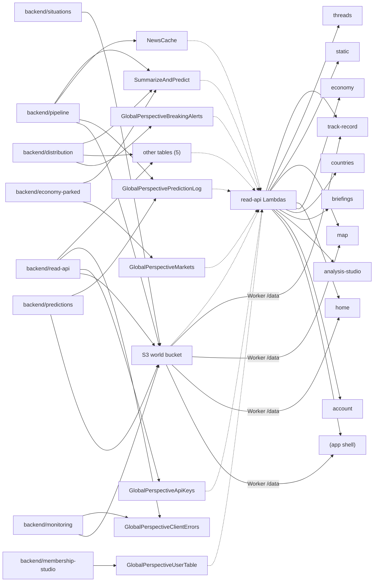

# Data links

Generated by scripts/gen-reference.mjs on 2026-10-20 — do not edit. Re-run `node scripts/gen-reference.mjs` after any change.

Sources: Lambda source (DynamoDB Put/Update/Delete vs Get/Query/Scan commands; S3 put vs get calls), `if (action === ...)` handlers in `backend/read-api/*/src`, `src/shared/api/restProxy.js` callers + `/data/` fetches, `src/app/App.jsx` routes, `*TABLE` env values, Function URLs and bucket listing from live AWS. Mode: live AWS ap-northeast-1, read-only.

One row per store: who writes it, who reads it, which browser read action serves it, which page shows it. **Heuristic, not proof.** It reads string literals and `const X = process.env.Y || 'lit'` defaults in each Lambda's own `src` (the shared `_shared` code has no store calls). Keys built only from variables are not found, so a row can miss a writer or reader; "none found" means exactly that, not "none exist". DynamoDB rows are keyed by table and the leading partition-key prefix (or `id`) found next to the command; `(key not resolved)` collects commands whose key is a variable. Read actions: the store calls inside each `if (action === ...)` block of a read-api Lambda and the local functions it calls (4 levels); a read-api Lambda with no action names counts as one endpoint (linked to pages through its `window.*_ENDPOINT` and the live Function URL in docs/config.js, so offline mode cannot link it). Pages: routes whose component, by imports, reaches a hook that calls the action (an upper bound: every module reachable from the route counts), or an S3 path fetched through the Worker `/data/` route; `(app shell)` is code outside the routes (nav, auth). Scripts under `scripts/`, Cloudflare Worker code and deployed zips that differ from the repo are not scanned.

| Store | Writers (Lambdas) | Readers (Lambdas) | Read actions | Pages |
|---|---|---|---|---|
| `env SOCIAL_POSTS_TABLE` `POSTED#` | `newsPostLinkedin` | `newsPostLinkedin` | none found | none found |
| `GlobalPerspectiveApiKeys` `(key not resolved)` | `newsSignals` | none found | none found | none found |
| `GlobalPerspectiveApiKeys` `RL#` | none found | `newsSignals` | `newsSignals (whole endpoint)` | none found |
| `GlobalPerspectiveBreakingAlerts` `(key not resolved)` | `newsBreakingAlert`, `newsEmailSender` | `newsBreakingAlert`, `newsRecommend` | `newsRecommend:get_alert`, `newsRecommend:list_alerts` | none found |
| `GlobalPerspectiveClientErrors` `(key not resolved)` | `newsClientErrors`, `newsErrorDigest` | `newsErrorDigest` | none found | none found |
| `GlobalPerspectiveMarkets` `(key not resolved)` | `newsMarketsData` | none found | none found | none found |
| `GlobalPerspectiveMarkets` `COMMODITIES#GLOBAL` | none found | `newsEconomicImpact`, `newsSensitiveData-dev` | `markets_global` | `/economy` |
| `GlobalPerspectiveMarkets` `CRYPTO#GLOBAL` | none found | `newsEconomicImpact`, `newsSensitiveData-dev` | `markets_global` | `/economy` |
| `GlobalPerspectiveMarkets` `EQUITIES#GLOBAL` | none found | `newsEconomicImpact`, `newsSensitiveData-dev` | `markets_global` | `/economy` |
| `GlobalPerspectiveMarkets` `FX#USD` | none found | `newsEconomicImpact`, `newsSensitiveData-dev` | `markets_country`, `markets_global` | `/`, `/economy`, `/weekly/country/:countryName` |
| `GlobalPerspectiveMarkets` `HISTORY#` | none found | `newsMarketsData`, `newsSensitiveData-dev`, `newsWeeklyMarkets` | `markets_global`, `markets_history` | `/economy` |
| `GlobalPerspectiveMarkets` `MACRO#` | none found | `newsSensitiveData-dev` | `markets_country` | `/`, `/weekly/country/:countryName` |
| `GlobalPerspectiveMarkets` `RATES#GLOBAL` | none found | `newsEconomicImpact`, `newsSensitiveData-dev` | `markets_global` | `/economy` |
| `GlobalPerspectiveMarkets` `TOPIC#` | none found | `newsSensitiveData-dev` | `markets_global`, `markets_history` | `/economy` |
| `GlobalPerspectivePredictionLog` `(key not resolved)` | `NewsProjectInvokeAgentLambda-dev`, `newsPredictionResolver` | `newsPredictionResolver`, `newsSensitiveData-dev` | `prediction_track_record` | `/today`, `/track-record`, `/track-record/text` |
| `GlobalPerspectivePredictionLog` `DRAFT#` | none found | `newsPredictionsSnapshot` | none found | none found |
| `GlobalPerspectivePredictionLog` `PRED#` | none found | `NewsProjectInvokeAgentLambda-dev`, `newsPredictionResolver`, `newsSensitiveData-dev` | `prediction_snapshot` | `/`, `/analyze`, `/briefings`, `/weekly/country/:countryName`, `/weekly/thread/:threadId` |
| `GlobalPerspectivePredictionLog` `Q#` | none found | `newsSensitiveData-dev` | `prediction_snapshot` | `/`, `/analyze`, `/briefings`, `/weekly/country/:countryName`, `/weekly/thread/:threadId` |
| `GlobalPerspectivePredictionLog` `SAMPLE#` | none found | `newsSensitiveData-dev` | `prediction_snapshot` | `/`, `/analyze`, `/briefings`, `/weekly/country/:countryName`, `/weekly/thread/:threadId` |
| `GlobalPerspectivePredictionLog` `SEED#` | none found | `newsPredictionResolver`, `newsSensitiveData-dev` | `prediction_snapshot` | `/`, `/analyze`, `/briefings`, `/weekly/country/:countryName`, `/weekly/thread/:threadId` |
| `GlobalPerspectivePredictionLog` `TOPIC#` | none found | `NewsProjectInvokeAgentLambda-dev` | none found | none found |
| `GlobalPerspectiveSavedItems` `(key not resolved)` | `newsSavedItems` | `newsRecommend`, `newsSavedItems` | `newsRecommend:follow_country`, `newsRecommend:unfollow_country`, `newsSavedItems:get_saved_items` | `/account`, `/briefings`, `/today`, `/track-record`, `/weekly/country/:countryName` |
| `GlobalPerspectiveShares` `(key not resolved)` | `newsSharedAnalysis` | `newsSharedAnalysis` | `newsSharedAnalysis (whole endpoint)` | `/analyze`, `/analyze/s/:id` |
| `GlobalPerspectiveUserPrefs` `(key not resolved)` | `newsRecommend` | `newsRecommend` | `newsRecommend:follow_country`, `newsRecommend:get_prefs`, `newsRecommend:set_prefs`, `newsRecommend:unfollow_country`, `newsRecommend:unsubscribe` | `/account`, `/briefings`, `/today`, `/track-record`, `/weekly/country/:countryName` |
| `GlobalPerspectiveUserTable` `(key not resolved)` | `newsAnalyze`, `newsPolarBilling` | `newsAnalyze`, `newsPolarBilling`, `newsRecommend`, `newsSensitiveData-dev` | `corrections_feed`, `country_history`, `newsRecommend:follow_country`, `newsRecommend:unfollow_country` | `/`, `/account`, `/analyze`, `/briefings`, `/today`, `/track-record`, `/track-record/text`, `/weekly/country/:countryName` |
| `NewsCache` `(key not resolved)` | `NewsProjectInvokeAgentLambda-dev` | `newsCountryIntelligence`, `newsDriftCorrector`, `newsEconomicImpact`, `newsPairIntelligence`, `newsSystemsAnalysis`, `newsThreadAnalysis`, `newsWeeklyBrief` | none found | none found |
| `NewsCache` `archive#` | `NewsProjectInvokeAgentLambda-dev` | `NewsProjectInvokeAgentLambda-dev`, `newsInvokeGemini-dev`, `newsSensitiveData-dev` | `archive_range`, `dossier_analysis`, `event_dossier`, `narrative_thread`, `prediction_snapshot` | `(app shell)`, `/`, `/analyze`, `/briefings`, `/weekly/countries`, `/weekly/country/:countryName`, `/weekly/thread/:threadId` |
| `NewsCache` `latest` | `NewsProjectInvokeAgentLambda-dev` | `NewsProjectInvokeAgentLambda-dev`, `newsBreakingAlert`, `newsDriftCorrector`, `newsPostLinkedin`, `newsRecommend`, `newsSensitiveData-dev` | `archive_range`, `dossier_analysis`, `event_dossier`, `narrative_thread`, `newsRecommend:follow_country`, `newsRecommend:unfollow_country`, `prediction_snapshot`, `rss` +1 more | `(app shell)`, `/`, `/account`, `/analyze`, `/briefings`, `/today`, `/track-record`, `/weekly/countries` +2 more |
| `NewsCache` `seen-today` | `newsInvokeGemini-dev` | `newsInvokeGemini-dev` | none found | none found |
| `NewsCache` `staging` | `newsInvokeGemini-dev` | `NewsProjectInvokeAgentLambda-dev` | none found | none found |
| `NewsCache` `today-archive` | `NewsProjectInvokeAgentLambda-dev` | `NewsProjectInvokeAgentLambda-dev`, `newsPostDevTo`, `newsSensitiveData-dev` | `rss`, `today` | `/`, `/analyze`, `/today` |
| `NewsProject-linkedin-posts` `(key not resolved)` | `newsPostDevTo` | `newsPostDevTo` | none found | none found |
| `SummarizeAndPredict` `(key not resolved)` | `NewsProjectInvokeAgentLambda-dev`, `newsCountryIntelligence`, `newsEconomicImpact`, `newsEconomicQuality`, `newsEmailSender`, `newsPairIntelligence`, `newsPostDevTo`, `newsSystemsAnalysis` +3 more | `NewsProjectInvokeAgentLambda-dev`, `newsBreakingAlert`, `newsCountryIntelligence`, `newsEconomicImpact`, `newsEconomicQuality`, `newsPairIntelligence`, `newsPostLinkedin`, `newsSensitiveData-dev` +3 more | `weekly_brief`, `weekly_markets` | `/`, `/account`, `/briefings`, `/economy` |
| `SummarizeAndPredict` `COUNTRY#` | none found | `newsPostDevTo`, `newsSensitiveData-dev` | `country_history`, `country_intelligence`, `country_preview`, `world_overview` | `/`, `/account`, `/analyze`, `/weekly/countries`, `/weekly/country/:countryName` |
| `SummarizeAndPredict` `DAILY_BRIEF#` | none found | `newsSensitiveData-dev` | `daily_brief` | `(app shell)`, `/`, `/about`, `/account`, `/briefings` |
| `SummarizeAndPredict` `DRIFT#` | `newsDriftCorrector` | `newsCountryIntelligence`, `newsDriftCorrector`, `newsSensitiveData-dev` | `corrections_feed`, `country_history`, `thread_analysis`, `world_overview` | `(app shell)`, `/`, `/account`, `/analyze`, `/today`, `/track-record`, `/track-record/text`, `/weekly/countries` +2 more |
| `SummarizeAndPredict` `DRIFTLOG#` | `newsDriftCorrector` | `newsSensitiveData-dev` | `country_history` | `/`, `/account`, `/analyze`, `/weekly/country/:countryName` |
| `SummarizeAndPredict` `ECON#` | none found | `newsSensitiveData-dev` | `economic_impact` | `/weekly/thread/:threadId` |
| `SummarizeAndPredict` `ECON#THREAD#` | none found | `newsEconomicQuality`, `newsSensitiveData-dev`, `newsWeeklyMarkets` | `economic_impact_list`, `economic_top_movers` | `/economy`, `/today`, `/weekly/countries`, `/weekly/country/:countryName` |
| `SummarizeAndPredict` `EMAILLOG#` | `newsEmailSender` | `newsEmailSender` | none found | none found |
| `SummarizeAndPredict` `FACTS#` | `newsCountryFactsUpdater` | `newsCountryFactsUpdater`, `newsCountryIntelligence`, `newsPairIntelligence`, `newsSensitiveData-dev` | `country_facts` | `/`, `/weekly/country/:countryName` |
| `SummarizeAndPredict` `HISTORY#` | `newsCountryIntelligence` | `newsDriftCorrector`, `newsSensitiveData-dev` | `country_history` | `/`, `/account`, `/analyze`, `/weekly/country/:countryName` |
| `SummarizeAndPredict` `PAIR#` | none found | `newsSensitiveData-dev` | `pair_analyses_list`, `pair_analysis` | none found |
| `SummarizeAndPredict` `SYSTEMS#` | none found | `newsSensitiveData-dev`, `newsSystemsAnalysis` | `dossier_analysis`, `event_dossier`, `systems_analysis`, `world_overview` | `/weekly/thread/:threadId` |
| `SummarizeAndPredict` `THREAD_HISTORY#` | `newsThreadAnalysis` | `newsDriftCorrector` | none found | none found |
| `SummarizeAndPredict` `THREAD#` | `NewsProjectInvokeAgentLambda-dev` | `newsPostDevTo`, `newsSensitiveData-dev` | `thread_analysis`, `thread_preview`, `web_index` | `(app shell)`, `/`, `/analyze`, `/weekly/countries`, `/weekly/country/:countryName`, `/weekly/thread/:threadId` |
| `SummarizeAndPredict` `TOPIC#` | `NewsProjectInvokeAgentLambda-dev` | `NewsProjectInvokeAgentLambda-dev`, `newsSensitiveData-dev` | `prediction`, `research_briefing`, `summary`, `trace_cause` | `/`, `/analyze`, `/today` |
| `SummarizeAndPredict` `WEB#INDEX` | `newsSystemsAnalysis` | `newsSensitiveData-dev` | `web_index` | `(app shell)`, `/`, `/analyze`, `/weekly/countries`, `/weekly/country/:countryName`, `/weekly/thread/:threadId` |
| `SummarizeAndPredict` `WEEKLY_BRIEF#` | none found | `newsSensitiveData-dev` | `weekly_brief` | `/`, `/account`, `/briefings` |
| S3 `audit/impact/` | `newsImpactAudit` | none found | none found | none found |
| S3 `audit/impact/latest.json` | `newsImpactAudit` | none found | none found | none found |
| S3 `audit/ingest-capture/` | `newsInvokeGemini-dev` | `newsSelectionShadow` | none found | none found |
| S3 `audit/ingest-capture/latest.json` | `newsInvokeGemini-dev` | `newsImpactAudit` | none found | none found |
| S3 `audit/selection-shadow/` | `newsSelectionShadow` | none found | none found | none found |
| S3 `audit/selection-shadow/latest.json` | `newsSelectionShadow` | none found | none found | none found |
| S3 `corpus/` | `newsSituationIngest` | `newsSelectionShadow` | none found | none found |
| S3 `corpus/gdacs/latest.json` | `newsGdacsIngest` | `newsImpactAudit` | none found | none found |
| S3 `corpus/gdelt/` | `newsGdeltConflict` | `newsImpactAudit` | none found | none found |
| S3 `predictions/track_record.json` | `newsPredictionsSnapshot` | `newsSensitiveData-dev` | `prediction_track_record` | `/today`, `/track-record`, `/track-record/text` |
| S3 `shadow/situations/` | `newsSituationTracker` | `newsSituationTracker` | none found | none found |
| S3 `shadow/situations/index.json` | `newsSituationTracker` | `newsSituationTracker` | none found | none found |
| S3 `signals/latest.json` | `newsSignals` | `newsSignals` | `newsSignals (whole endpoint)` | none found |
| S3 `signals/snapshots/` | `newsSignals` | none found | none found | none found |
| S3 `situations/archive/` | `newsSituationTracker` | none found | none found | none found |
| S3 `situations/history/` | `newsSituationTracker` | none found | none found | none found |
| S3 `situations/inbox/` | `newsSituationTracker` | none found | none found | none found |
| S3 `situations/inbox/gdacs-latest.json` | `newsGdacsIngest` | `newsSituationTracker` | none found | none found |
| S3 `situations/index.json` | `newsSituationTracker` | `newsSituationTracker` | none found | none found |
| S3 `situations/state/` | `newsSituationTracker` | `newsSelectionShadow`, `newsSituationTracker` | none found | `(app shell)`, `/` |
| S3 `stories/classify-cache.json` | `newsSituationIngest` | `newsSituationIngest` | none found | none found |
| S3 `stories/index.json` | `newsSituationIngest` | `newsSituationIngest`, `newsSituationTracker` | none found | none found |
| S3 `stories/state/` | `newsSituationIngest` | `NewsProjectInvokeAgentLambda-dev` | none found | none found |
| S3 `threads/story-map.json` | `NewsProjectInvokeAgentLambda-dev` | `newsSituationTracker` | none found | none found |
| S3 `web/latest.json` | `newsSystemsAnalysis` | none found | none found | none found |
| S3 `world/latest.json` | `newsSituationTracker` | none found | none found | `(app shell)`, `/` |
| S3 `world/latest.member.json` | `newsSituationTracker` | none found | none found | none found |
| S3 `world/shadow/` | `newsSituationTracker` | none found | none found | none found |
| S3 `world/shadow/latest.json` | `newsSituationTracker` | none found | none found | none found |
| S3 `world/shadow/latest.member.json` | `newsSituationTracker` | none found | none found | none found |
| `GlobalPerspectiveImpactAudit` `(any key)` | none found | none found | none found | none found |
| `GlobalPerspectiveIngestCapture` `(any key)` | none found | none found | none found | none found |
| S3 `tags/` | none found in repo source | none found | none found | none found |

82 rows (79 found in code, 3 only in live AWS). 50 action handlers in 6 read-api Lambdas; no action names in `newsClientErrors`, `newsSharedAnalysis`, `newsSignals`.

## Flow (Lambda groups, stores, read API, pages)

Dashed: read by a read-api Lambda. Lambda-to-Lambda reads are in the table above, not drawn. 30 nodes.

